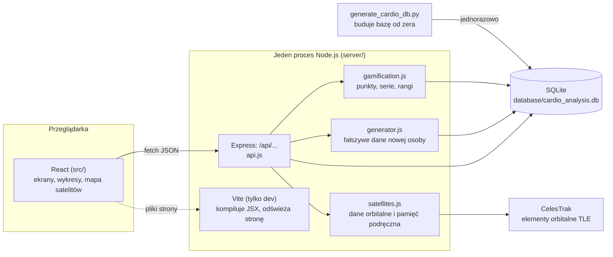
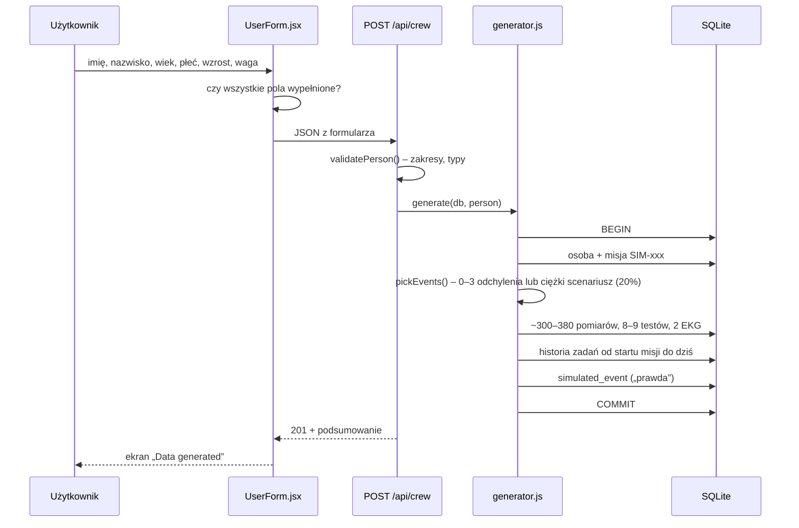
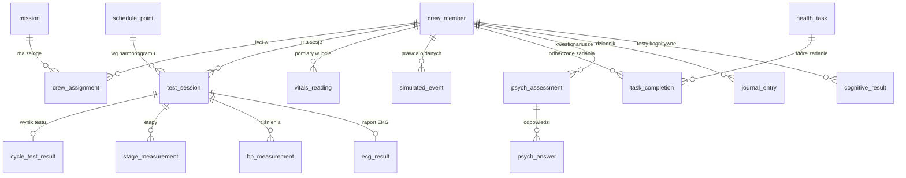

# Health Monitor – system monitorowania zdrowia astronautów

Długie misje kosmiczne wystawiają astronautów na promieniowanie, izolację, zmienioną grawitację
i zamknięte, wrogie środowisko. Skutki to m.in. zmiany odporności, utrata masy kostnej, zdarzenia
sercowo-naczyniowe i problemy psychiczne. Na długiej misji lekarz jest daleko, więc astronauta sam
musi zauważyć, że coś się z nim dzieje.

**Health Monitor** to aplikacja, w której astronauta śledzi własne zdrowie: kolorowe oznaczenia
parametrów życiowych, sylwetka ciała pokazująca, co działa dobrze, wykresy z całej misji, wyniki
testów wydolności i EKG, kwestionariusz samopoczucia, testy kognitywne, codzienne zadania
z punktami i odznakami oraz proste wyjaśnienia każdego pomiaru. Zawiera też wizualizację satelitów
na mapie świata z ich bieżącą pozycją, śladem orbity i podstawowymi danymi orbitalnymi.

> **Ważne:** wszystkie dane osobowe i medyczne w tym projekcie są **syntetyczne** (wymyślone,
> wygenerowane kodem). Prawdziwe są tylko tabele referencyjne przepisane z dokumentów NASA.
> Aplikacja nie jest wyrobem medycznym i nie zastępuje lekarza.

## Spis treści

1. [Szybki start](#1-szybki-start)
2. [Architektura w skrócie](#2-architektura-w-skrócie)
3. [Struktura katalogów](#3-struktura-katalogów)
4. [Jak płyną dane](#4-jak-płyną-dane)
5. [Baza danych](#5-baza-danych)
6. [Model fizjologiczny – skąd biorą się liczby](#6-model-fizjologiczny--skąd-biorą-się-liczby) (w tym [profile odstające](#66-profile-odstające-outliers))
7. [Serwer – plik po pliku](#7-serwer--plik-po-pliku)
8. [Frontend – plik po pliku](#8-frontend--plik-po-pliku)
9. [Reguły kolorów i progi](#9-reguły-kolorów-i-progi)
10. [Testy](#10-testy)
11. [Wnioski z analizy kodu](#11-wnioski-z-analizy-kodu)
12. [Co poprawić w pierwszej kolejności](#12-co-poprawić-w-pierwszej-kolejności)
13. [Słowniczek](#13-słowniczek)

---

## 1. Szybki start

Wymagania: **Node.js 22.13 lub nowszy** (projekt używa wbudowanego modułu `node:sqlite`; testowane
na Node 26). Python 3 jest potrzebny tylko do odtworzenia bazy od zera.

```bash
npm install
```

```bash
npm run dev
```

Aplikacja działa pod adresem http://localhost:5173 (API i strona na tym samym porcie).
Do pobierania danych orbitalnych wizualizacja satelitów potrzebuje połączenia z internetem.

| Polecenie | Co robi |
|---|---|
| `npm run dev` | serwer Express + Vite z odświeżaniem strony na żywo |
| `npm run build` | buduje frontend do katalogu `dist/` |
| `npm start` | tryb produkcyjny: serwuje `dist/` (wymaga wcześniejszego `npm run build`) |
| `npm test` | testy API na tymczasowej kopii bazy (prawdziwej nie zmieniają) |
| `npm run seed:outliers` | dodaje 8 profili demonstracyjnych z poważnymi problemami zdrowotnymi ([rozdz. 6.6](#66-profile-odstające-outliers)) |
| `python3 database/generate_cardio_db.py` | odtwarza bazę od zera (**kasuje** użytkowników dodanych w aplikacji) |

Zmienne środowiskowe:

| Zmienna | Znaczenie | Domyślnie |
|---|---|---|
| `PORT` | port serwera | `5173` |
| `CARDIO_DB` | ścieżka do pliku bazy (np. kopii do eksperymentów) | `database/cardio_analysis.db` |
| `NODE_ENV` | `production` włącza serwowanie `dist/` zamiast Vite | brak (tryb deweloperski) |

Trzy rzeczy, o które łatwo się potknąć:

- **Windows / PowerShell.** Jeśli PowerShell blokuje `npm` komunikatem o wyłączonym uruchamianiu
  skryptów, użyj `npm.cmd run dev`. Skrypt `npm start` ma składnię `NODE_ENV=production node ...`,
  która działa w bashu, ale nie w `cmd` ani PowerShellu. Tam ustaw zmienną osobno
  (`$env:NODE_ENV = 'production'`), a potem uruchom `node server/index.js`.
- **Zmiany w `server/` wymagają restartu.** Vite odświeża na żywo tylko kod z `src/`. Kod serwera
  jest wczytywany raz, przy starcie. Po edycji API zatrzymaj serwer (Ctrl+C) i uruchom go ponownie,
  inaczej przeglądarka dalej rozmawia ze starą wersją.
- **Zajęty port.** Komunikat `Port 5173 is already in use` oznacza, że działa już druga kopia
  aplikacji. Zatrzymaj ją albo wybierz inny port zmienną `PORT`.

---

## 2. Architektura w skrócie

Aplikacja ma trzy warstwy i jeden proces:



| Warstwa | Technologia | Dlaczego tak |
|---|---|---|
| Frontend | React 18 + Vite, Recharts | szybkie odświeżanie w trakcie pracy, gotowe wykresy |
| Mapa satelitów | satellite.js, d3-geo, topojson-client, world-atlas | orbity liczone w przeglądarce, kontury lądów bez plików graficznych |
| Backend | Express 4 | kilkanaście prostych endpointów JSON |
| Baza | SQLite przez wbudowany `node:sqlite` | jeden plik, zero instalacji, brak natywnych modułów do kompilowania |
| Dane startowe | skrypt Pythona ze stałym ziarnem losowości | każde uruchomienie skryptu daje te same dane |

Najważniejsze decyzje projektowe:

- **Jeden port, jeden proces.** W trybie deweloperskim Vite działa *wewnątrz* Expressa jako
  middleware. Nie ma osobnego serwera frontendu ani konfiguracji proxy, a websocket odświeżania
  korzysta z tego samego serwera HTTP.
- **Baza jest źródłem prawdy, wszystko inne jest wyliczane.** Punkty, serie, rangi i odznaki nie są
  nigdzie zapisane. Serwer liczy je przy każdym zapytaniu z tabeli `task_completion`. Odhaczenie
  zadania to wstawienie wiersza, cofnięcie to jego usunięcie.
- **Wspólny kod przeglądarki i serwera.** `src/assessments.js` (pytania kwestionariusza i funkcja
  punktująca) importuje zarówno ekran, jak i serwer. Dzięki temu wynik liczy serwer i nie da się go
  podmienić w przeglądarce.
- **Dane syntetyczne mają „prawdę”.** Każde celowo zasymulowane odchylenie od normy jest zapisane
  w tabeli `simulated_event`. Można więc sprawdzić, czy analiza wykrywa to, co naprawdę zostało
  wstawione.
- **Brak logowania.** „Log in” to wybór profilu z listy. Świadome uproszczenie na potrzeby
  hackathonu, opisane szerzej w [rozdziale 11](#11-wnioski-z-analizy-kodu).

---

## 3. Struktura katalogów

```
HackatonHealthMonitoringSystem/
├── index.html                 strona-wydmuszka: <div id="root"> + src/main.jsx
├── package.json               skrypty npm i zależności
├── vite.config.js             Vite z wtyczką React
├── .cache/celestrak/          kopie danych satelitarnych (tworzone samo, poza gitem)
│
├── server/                    backend (Node.js)
│   ├── index.js               punkt startu: Express + Vite (dev) albo dist/ (produkcja)
│   ├── db.js                  otwarcie bazy, brakujące tabele, transakcje
│   ├── api.js                 wszystkie endpointy /api
│   ├── generator.js           generator fałszywych danych dla nowej osoby
│   ├── gamification.js        punkty, serie, rangi, odznaki
│   ├── satellites.js          pobieranie i pamięć podręczna danych orbitalnych z CelesTrak
│   ├── seed-outliers.js       dodaje profile „Outlier …” z poważnymi problemami
│   ├── api.test.js            testy API (node:test)
│   └── satellites.test.js     testy danych orbitalnych (node:test)
│
├── src/                       frontend (React)
│   ├── main.jsx               montuje <App /> w #root
│   ├── App.jsx                mały router oparty o "#" w adresie
│   ├── router.js              go(ścieżka): zmiana ekranu
│   ├── api.js                 klient API (fetch + obsługa błędów)
│   ├── vitals.js              definicje parametrów i reguła zielony/żółty/czerwony
│   ├── assessments.js         pytania i testy (wspólne z serwerem)
│   ├── styles.css             cały wygląd, jasny i ciemny motyw
│   └── screens/
│       ├── Login.jsx          wybór profilu, dodawanie i usuwanie
│       ├── UserForm.jsx       formularz „Generate user data”
│       ├── Dashboard.jsx      panel: Overview, Vitals, Fitness, ECG + zakładki
│       ├── BodyMap.jsx        sylwetka ciała z kolorami stanu
│       ├── Wellbeing.jsx      kwestionariusz, dziennik, oddech, medytacja
│       ├── Cognitive.jsx      6 testów kognitywnych
│       ├── Tasks.jsx          zadania dnia i grywalizacja
│       ├── Guide.jsx          poradnik po wskaźnikach
│       └── Satellites.jsx     mapa satelitów i bieżące dane orbitalne
│
├── database/
│   ├── cardio_analysis.db     baza SQLite (w repozytorium)
│   ├── schema.sql             schemat: tabele, indeksy, widoki
│   ├── schema.dbml            ten sam schemat w formacie DBML (do diagramów)
│   ├── generate_cardio_db.py  buduje bazę od zera
│   └── README.md              szczegółowy opis danych
│
└── statsscreen.cpp / .h / .ui pusty szkielet okna Qt (nieużywany, patrz rozdz. 11)
```

---

## 4. Jak płyną dane

### 4.1. Nowy użytkownik („Generate user data”)



Całość działa w jednej transakcji: jeśli cokolwiek się nie uda, w bazie nie zostaje pół profilu.

### 4.2. Otwarcie panelu

1. `Login.jsx` pobiera `GET /api/crew` i pokazuje listę profili.
2. Kliknięcie „Log in” zmienia adres na `#/crew/<id>`. `App.jsx` widzi zmianę i rysuje `Dashboard`.
3. `Dashboard.jsx` wysyła **jedno** zapytanie `GET /api/crew/<id>/dashboard` i dostaje wszystko dla
   czterech pierwszych zakładek: dane osoby, misje, pomiary w locie, zakresy norm, testy, EKG
   i zasymulowane zdarzenia.
4. Zakładki Wellbeing, Cognitive, Daily tasks i Guide dociągają swoje dane dopiero po otwarciu.
5. Sylwetka ciała (`BodyMap.jsx`) korzysta z danych panelu i dociąga tylko wyniki kwestionariusza.

Ekran Satellite tracker pobiera wybraną grupę satelitów z `/api/satellites`; pozycje i ślad orbity
są obliczane w przeglądarce z elementów orbitalnych TLE.

### 4.3. Lista endpointów

Wszystkie ścieżki zaczynają się od `/api`. Odpowiedzi to JSON, a błędy mają postać
`{ "error": "komunikat" }`.

| Metoda i ścieżka | Co robi | Kody odpowiedzi |
|---|---|---|
| `GET /crew` | lista profili dodanych w aplikacji | 200 |
| `POST /crew` | tworzy osobę i generuje jej dane | 201, 400 (z listą `fields`), 500 |
| `DELETE /crew/:id` | usuwa osobę ze wszystkimi danymi | 204, 404 |
| `GET /crew/:id/dashboard?mission=` | dane panelu (misja opcjonalna) | 200, 403, 404 |
| `GET /crew/:id/tasks` | zadania, odhaczone dziś, podsumowanie | 200, 403, 404 |
| `POST /crew/:id/tasks/:taskId` | `{ "done": true/false }` – odhacza lub cofa | 200, 403, 404 |
| `GET /crew/:id/wellbeing` | historia kwestionariuszy i dziennik | 200, 403, 404 |
| `POST /crew/:id/psych` | `{ "answers": [10 liczb] }` – serwer liczy wynik | 201, 400, 403, 404 |
| `POST /crew/:id/journal` | `{ "text": "..." }` – wpis dziennika | 201, 400, 403, 404 |
| `GET /crew/:id/cognitive` | historia testów kognitywnych | 200, 403, 404 |
| `POST /crew/:id/cognitive` | zapis wyniku jednego testu | 201, 400, 403, 404 |
| `GET /guide` | tematy poradnika | 200 |
| `GET /satellites` | dostępne grupy satelitów | 200 |
| `GET /satellites?group=<kod>` | elementy orbitalne TLE wybranej grupy | 200, 400 (nieznana grupa), 502 |

**403** dotyczy załogi referencyjnej (patrz niżej): jej danych nie da się odczytać przez API.
Dane satelitarne pochodzą z CelesTrak i są przechowywane w pamięci podręcznej serwera przez
2 godziny (także na dysku, w `.cache/celestrak/`). Jeśli odświeżenie się nie powiedzie, serwer
zwraca ostatnią poprawnie pobraną kopię z polem `"stale": true`.

### 4.4. Załoga referencyjna a profile z aplikacji

W bazie są dwa rodzaje osób, rozróżniane kolumną `crew_member.created_in_app`:

| | Załoga referencyjna (`0`) | Profile z aplikacji (`1`) |
|---|---|---|
| Skąd | skrypt Pythona, 15 osób | formularz „Generate user data” |
| Rola | wzorzec do analiz („blueprint”) | zwykli użytkownicy aplikacji |
| Lista logowania | **niewidoczna** | widoczna |
| Odczyt danych przez API | **403** | dozwolony |
| Usuwanie | dozwolone przez API (niedostępne z ekranu) | dozwolone |

Blokada odczytu jest w jednym miejscu: `api.param('id', ...)` w `server/api.js` uruchamia się przed
każdą trasą z `:id` w ścieżce. Kod serwera (generator, widoki SQL, zapytania analityczne) czyta
bazę bezpośrednio, więc nadal ma dostęp do wzorca.

---

## 5. Baza danych

Pełny opis tabel i przykładowe zapytania są w [database/README.md](database/README.md). Tu jest
mapa całości.

### 5.1. Cztery grupy tabel

| Grupa | Tabele | Pochodzenie |
|---|---|---|
| **Referencyjne** | `medical_requirement`, `schedule_point`, `protocol_stage`, `termination_criterion`, `test_constraint`, `equipment` | przepisane z dokumentów NASA MRID JSC 28913: MEDB 1.6 (EKG spoczynkowe) i N3.07 (test na cykloergometrze) |
| **Normy** | `reference_range` | ogólne wartości kliniczne dla dorosłych, **nie** z dokumentów NASA |
| **Dane załogi** | `crew_member`, `mission`, `crew_assignment`, `test_session`, `cycle_test_result`, `stage_measurement`, `bp_measurement`, `ecg_result`, `vitals_reading`, `simulated_event` | syntetyczne |
| **Aplikacja** | `health_task`, `task_completion`, `indicator_guide`, `psych_assessment`, `psych_answer`, `journal_entry`, `cognitive_result` | definicje ze skryptu, wpisy z aplikacji |

### 5.2. Jak tabele wiążą się ze sobą



Kluczowa jest tabela **`test_session`**: jedna sesja to jedno badanie w konkretnym dniu. Test na
rowerze ma do sesji wynik zbiorczy, pomiary z każdego etapu i ciśnienia. EKG ma do sesji jeden
raport. Punkt harmonogramu (`schedule_point`) mówi, *które* to badanie: L-90/30 d, FD 14, R+5 itd.

### 5.3. Widoki do analizy

| Widok | Co pokazuje |
|---|---|
| `v_session_overview` | wszystkie sesje z nazwiskiem, misją i etykietą harmonogramu |
| `v_vo2_trend` | VO₂peak w czasie i % zmiany względem testu L-90/30 d |
| `v_vitals_alerts` | pomiary w locie poza normą (`warning` / `critical`) |
| `v_ecg_findings` | nieprawidłowe EKG |

### 5.4. Ile tego jest

Świeżo wygenerowana baza: 15 osób, 4 misje (HMS-1 … HMS-4), 155 sesji testów, około 4400 pomiarów
w locie i około 34 tysięcy odhaczonych zadań (syntetyczna historia grywalizacji). Każdy profil
dodany w aplikacji dokłada jedną misję `SIM-xxx`, 10–11 sesji i 300–380 pomiarów.

### 5.5. Zgodność wsteczna

`server/db.js` przy starcie tworzy tabele `simulated_event`, `psych_assessment`, `psych_answer`,
`journal_entry` i `cognitive_result`, jeśli ich nie ma (`CREATE TABLE IF NOT EXISTS`). Starsza
kopia bazy zadziała więc bez osobnej migracji.

---

## 6. Model fizjologiczny – skąd biorą się liczby

To najciekawsza część kodu. Dane nie są losowym szumem: każda osoba ma własny punkt wyjścia,
a wszystkie pomiary z niego wynikają. Ten sam model jest zapisany dwa razy: w Pythonie
(`database/generate_cardio_db.py`, załoga referencyjna) i w JavaScripcie (`server/generator.js`,
profile z aplikacji).

### 6.1. Osobista linia bazowa

Dla każdej osoby losowane są raz:

| Parametr | Zakres | Uwagi |
|---|---|---|
| VO₂peak przed lotem | 39–48 (M), 33–42 (K) ml/kg/min | regularni kolarze z załogi referencyjnej +3 |
| Współczynnik „responder” | 0,5–1,3 | 1 = przeciętna utrata wydolności w locie |
| Tętno spoczynkowe | 52–68 /min | |
| Ciśnienie spoczynkowe | 108–126 / 66–80 mmHg | |
| Temperatura skóry | 33,6–34,3 °C | |
| Oddechy | 13–16 /min | |
| Odstępy EKG | PR 135–185, QRS 84–102, QTc 388–425 ms | QTc u kobiet +10 ms |

Każda późniejsza wartość to:
**linia bazowa + wpływ fazy lotu + ewentualne odchylenie + szum pomiarowy**.

### 6.2. Wydolność w kolejnych fazach misji

Średni mnożnik VO₂peak względem wartości sprzed lotu:

| Test | Mnożnik | Znaczenie |
|---|---|---|
| L-90/30 d (stojąc) | 1,00 | punkt odniesienia |
| L-90/30 d (leżąc) | 0,92 | pozycja leżąca daje niższy wynik |
| FD 14 | 0,86 | największy spadek na początku lotu |
| FD 75 | 0,90 | częściowa poprawa dzięki ćwiczeniom |
| R-14 | 0,92 | |
| R+5 | 0,85 | tuż po lądowaniu, powrót do grawitacji |
| R+30 | 0,96 | prawie pełna odbudowa po miesiącu |

Dla testów w locie i po locie strata jest mnożona przez osobisty „responder”. Ktoś ze
współczynnikiem 0,5 traci na FD 14 około 7%, a ktoś z 1,3 około 18%.

### 6.3. Od VO₂peak do przebiegu testu

1. **Moc szczytowa.** Wzór ACSM dla jazdy na rowerze: `VO₂ = 10,8 × W / masa + 7` (ml/kg/min).
   Kod rozwiązuje go względem watów: `W = (VO₂peak − 7) × masa / 10,8`.
2. **Etapy.** Protokół N3.07: pierwszy etap 3 minuty, potem co minutę wyższe obciążenie.
   *Nominal*: 50, 75, 100 … 475 W. *Light* (poniżej 65 kg): 45, 60, 75 … 300 W. Zaliczone są
   wszystkie etapy do mocy szczytowej.
3. **Limit na stacji.** Rower CEVIS ma limit 350 W. Po jego osiągnięciu ostatni etap jest wydłużany
   do 3 minut.
4. **Tętno szczytowe.** Wzór Tanaki: `208 − 0,7 × wiek`, z osobistym przesunięciem ±6.
5. **Tętno i zmęczenie na etapach** rosną razem z udziałem drogi od spoczynku do szczytu.
6. **RER** (stosunek wydychanego CO₂ do zużytego O₂) co najmniej 1,10 oznacza wysiłek naprawdę
   maksymalny. Test przerwany ma 1,00–1,06.
7. **Ciśnienie.** Skurczowe rośnie o około 0,27 mmHg na wat, a po teście opada wykładniczo.
8. **Brak analizatora gazów** oznacza brak wartości VO₂ (w bazie `NULL`).

### 6.4. Pomiary w locie

Dwa pomiary dziennie (około 06:00 i 19:00) przez całą misję:

- **Adaptacja do nieważkości.** Przez pierwsze 10 dni płyny przesuwają się w stronę głowy.
  Ciśnienie spada o około 4/2 mmHg, tętno o około 3 uderzenia.
- **Rytm dobowy.** Wieczorem ciśnienie skurczowe +3 mmHg, tętno +6, temperatura skóry +0,3 °C.
- **Szum** o rozkładzie normalnym (ciśnienie ±4, tętno ±3, SpO₂ ±0,6).

### 6.5. Odchylenia od normy

Każdy profil z aplikacji dostaje losowo: 0 odchyleń (20% szans), 1 (40%), 2 (28%) lub 3 (12%),
bez powtórzeń, z listy jedenastu:

| Rodzaj | Czas trwania | Co się zmienia |
|---|---|---|
| `hypertension` | 25–50 dni, druga połowa misji | ciśnienie rośnie stopniowo: +12 → +28 / +7 → +16 mmHg |
| `hypotension` | 4–8 dni | ciśnienie −20…−26 / −10…−14, tętno +8 |
| `tachycardia` | 3–6 dni | tętno spoczynkowe 102–125, oddechy +1,5 |
| `bradycardia` | 10–20 dni | tętno −13 |
| `fever` | 3–6 dni | temperatura skóry +1,5…+2, tętno +14, oddechy +2,5 |
| `co2` | 3–5 dni | oddechy +4,5…+6, SpO₂ −2,3…−3,5, tętno +6 |
| `desaturation` | 1–3 dni | SpO₂ −6…−8,5, oddechy +3, tętno +10 |
| `artifacts` | 4–8 pojedynczych pomiarów | jedna niewiarygodna wartość przy pozostałych w normie |
| `deconditioning` | cała misja | „responder” 1,8–2,1: VO₂peak spada o 25–30% |
| `ecg` | EKG po locie | blok AV I stopnia, wydłużony QTc albo pojedyncze PVC |
| `test_stopped` | test R+5 | przerwany z powodu duszności |

Dwie rzeczy są tu przemyślane:

- **Choroba zmienia kilka parametrów naraz.** Gorączka to temperatura *i* tętno *i* oddech.
  Analiza może więc rozpoznawać wzorzec, a nie tylko pojedynczą wartość poza normą.
- **Artefakt czujnika wygląda inaczej niż choroba.** Jedna absurdalna wartość (SpO₂ 82%, tętno
  155) w pojedynczym pomiarze, przy reszcie w normie. Dobra analiza powinna to uznać za błąd
  pomiaru.

Wszystko, co zostało zasymulowane, trafia do `simulated_event` z dniami początku i końca.

### 6.6. Profile odstające (outliers)

80% generowanych profili otrzymuje 0–3 zwykłe odchylenia, często widoczne tylko jako żółte kafelki
w środku misji. Pozostałe 20% otrzymuje jeden z pięciu losowych scenariuszy z **silnymi**
problemami. Dodatkowo do demonstracji można utworzyć osiem nazwanych profili odstających.
Ich nazwy od razu mówią, co jest nie tak:

| Profil na liście logowania | Co pokazuje panel |
|---|---|
| Outlier Hypertension (severe) | ciśnienie narastające do ok. 175/105 mmHg (czerwone) |
| Outlier Hypotension + Bradycardia | ciśnienie poniżej 70/45, tętno poniżej 40 (czerwone) |
| Outlier Fever + Tachycardia | temperatura skóry ok. 37,5 °C, tętno ponad 130 (czerwone) |
| Outlier Low Oxygen (SpO2) + High CO2 | SpO₂ ok. 80%, oddechy ponad 25 /min (czerwone) |
| Outlier Fitness Loss + Stopped Test | VO₂peak ponad 25% poniżej wartości sprzed lotu, przerwany test R+5 (czerwone nogi) |
| Outlier Abnormal ECG (long QTc) | wydłużony QTc ponad 460 ms w EKG po locie (żółte serce) |
| Outlier Low Mood + Poor Sleep | kwestionariusz z wynikiem ok. 7% (żółty mózg) |
| Outlier Multi-System Failure | wszystko naraz: ciśnienie, gorączka, niedotlenienie, wydolność, EKG, nastrój |

```bash
npm run seed:outliers
```

Jak to działa:

- `server/seed-outliers.js` wywołuje ten sam generator co formularz, ale z opcją `outlier`.
  Generator bierze wtedy dokładnie podane odchylenia, w **ostrej** wersji (wartości sięgają
  zakresu czerwonego), a epizody trwają do ostatniego dnia lotu. Dzięki temu widać je w ostatnim
  pomiarze, czyli na kafelkach i na sylwetce ciała.
- Przy silnej utracie wydolności spadek utrzymuje się także po powrocie (test R+30), żeby nogi na
  sylwetce zostały czerwone.
- To zwykłe profile z aplikacji (`created_in_app = 1`): są na liście logowania i można je usunąć
  przyciskiem Delete user. Skrypt można uruchamiać wielokrotnie: profil o istniejącej nazwie
  jest pomijany.
- EKG i nastrój mają na sylwetce co najwyżej kolor żółty, bo tak działają ich reguły (rozdz. 9).
- Test w `server/api.test.js` sprawdza, że każdy profil odstający ma oczekiwane wartości
  w czerwonym zakresie.

#### Możliwe przyczyny i fałszywe alarmy

Poniższe przykłady pokazują, że podobne objawy mogą mieć różne przyczyny. Przed uznaniem
nieprawidłowego wyniku za problem zdrowotny należy sprawdzić, czy nie wynika z błędu pomiaru.

| Wzorzec | Możliwe przyczyny w locie kosmicznym | Możliwy błąd pomiaru |
|---|---|---|
| Nadciśnienie | stres i obciążenie pracą, niedobór snu, dużo soli w posiłkach, wysokie stężenie CO₂ w kabinie, wcześniejsze nadciśnienie | źle dobrany mankiet, pomiar tuż po wysiłku lub podczas rozmowy |
| Niskie ciśnienie i bradykardia | odwodnienie, przesunięcie płynów w stanie nieważkości, osłabienie układu krążenia, działanie leków, naturalnie niskie tętno u wytrenowanej osoby | pomiar zaraz po przebudzeniu, źle umieszczony czujnik |
| Gorączka i tachykardia | infekcja, reaktywacja utajonego wirusa, odwodnienie, przegrzanie podczas ćwiczeń lub spaceru kosmicznego | czujnik skóry ogrzany wysiłkiem lub wysoką temperaturą otoczenia |
| Niskie SpO₂ i wysokie CO₂ | problem z oczyszczaniem powietrza lub jego przepływem w kabinie, infekcja dróg oddechowych, płyn w płucach | zimne palce albo źle założony pulsoksymetr |
| Utrata wydolności i przerwany test | zbyt mało ćwiczeń, awaria sprzętu, kontuzja, osłabienie mięśni i serca w stanie nieważkości, zaburzenie rytmu podczas wysiłku | wysiłek nie był maksymalny albo analizator gazów działał nieprawidłowo |
| Nieprawidłowe EKG (długi QTc) | niski poziom potasu lub magnezu, leki wydłużające QTc, zmiany pracy serca po długim locie | nieprawidłowe umieszczenie elektrod, zawyżona korekta QTc przy wysokim tętnie |
| Obniżony nastrój i problemy ze snem | izolacja, brak zwykłego rytmu dnia i nocy, hałas, obciążenie pracą, konflikty w załodze, oddalenie od bliskich | odpowiedzi w gorszym momencie; pojedynczy niski wynik nie jest trendem |
| Problemy wielu układów naraz | jedna poważna przyczyna, np. infekcja lub awaria systemu powietrza w kabinie | jednoczesna awaria wielu czujników jest mało prawdopodobna |

Przy ocenie wyników pomagają trzy wskazówki:

- **Czy problem dotyczy całej załogi?** Niskie SpO₂ lub wysokie CO₂ u kilku osób jednocześnie
  może wskazywać na problem z powietrzem w kabinie. Taki wzorzec zasymulowano w misji HMS-2.
- **Czy to pojedynczy pomiar, czy utrzymujący się trend?** Pojedynczy skrajny wynik otoczony
  prawidłowymi pomiarami częściej wskazuje na artefakt czujnika. Generator symuluje także takie
  błędy.
- **Czy parametry zmieniają się w powiązany sposób?** Gorączce zwykle towarzyszy wzrost tętna
  i częstości oddechów. Sama wysoka temperatura przy prawidłowych pozostałych pomiarach może
  wskazywać na błąd czujnika.

To ogólne informacje edukacyjne, a nie porada medyczna. W prawdziwej misji ocenę stanu zdrowia
prowadzi lekarz misji.

---

## 7. Serwer – plik po pliku

### `server/index.js` – punkt startu

Otwiera bazę, tworzy aplikację Express i ręcznie tworzy serwer HTTP (żeby Vite mógł podpiąć pod
niego swój websocket). Najpierw montuje API pod `/api`. Potem, zależnie od trybu, serwuje gotowe
pliki z `dist/` albo uruchamia Vite jako middleware. Obsługuje też błąd zajętego portu czytelnym
komunikatem.

### `server/db.js` – dostęp do bazy

- `openDb()` sprawdza, czy plik istnieje, włącza klucze obce (`PRAGMA foreign_keys = ON`; SQLite ma
  je domyślnie wyłączone dla każdego połączenia), robi próbne zapytanie i dotwarza brakujące tabele.
- `transaction(db, fn)` to `BEGIN` / `COMMIT`, a przy wyjątku `ROLLBACK`. Moduł `node:sqlite` jest
  synchroniczny, więc w środku transakcji nic innego się nie wykona.
- `plain(rows)` zamienia wiersze na zwykłe obiekty (wygodniejsze dla JSON i testów).

### `server/api.js` – endpointy

Funkcja `createApi(db)` dostaje bazę jako argument. Dzięki temu testy uruchamiają to samo API na
tymczasowej kopii. Warto znać cztery miejsca:

- **Strażnik `api.param('id')`** – jedno miejsce, które blokuje odczyt danych załogi referencyjnej.
- **`DELETE /crew/:id`** – schemat nie ma `ON DELETE CASCADE`, więc usuwanie idzie ręcznie, od
  dzieci do rodziców: wyniki sesji → wiersze osoby → osoba → misje, z których nikt już nie
  korzysta.
- **`GET /crew/:id/dashboard`** – składa odpowiedź z siedmiu zapytań i dolicza do każdego testu
  `pct_vs_preflight`, czyli zmianę VO₂peak względem testu L-90/30 d (stojąc) z tej samej misji.
- **`POST /crew/:id/psych`** – serwer sam liczy wynik funkcją `scorePsych` i w jednej transakcji
  zapisuje ocenę, odpowiedzi oraz odhacza zadanie dnia „How do you feel?”.

### `server/satellites.js` – dane orbitalne

Pobiera z CelesTrak elementy orbitalne TLE dla wybranej grupy satelitów i udostępnia je przez
`GET /api/satellites`. Ważne szczegóły:

- **Lista dozwolonych grup** (`SATELLITE_GROUPS`). Nieznany kod daje 400, więc przez serwer nie da
  się wysłać do CelesTrak dowolnego zapytania.
- **Pamięć podręczna na 2 godziny**, w pamięci procesu i w plikach `.cache/celestrak/<grupa>.json`
  (katalog jest w `.gitignore`). CelesTrak aktualizuje dane co ok. 2 godziny i **odmawia**
  ponownego pobrania tej samej grupy w tym czasie. Bez kopii na dysku każdy restart serwera
  oznaczałby nawet 2 godziny bez danych.
- **Ostatnia dobra kopia.** Gdy odświeżenie się nie uda (brak sieci, odmowa CelesTrak), serwer
  zwraca poprzednie dane z `stale: true`, a ekran wyświetla o tym informację.
- **`parseTle()`** czyta format trzyliniowy (nazwa, linia 1, linia 2) i pomija wszystko inne, np.
  tekstowe komunikaty błędów, które CelesTrak wysyła z kodem 200.

### `server/generator.js` – generator danych

Klasa `Generator` buduje jedną osobę. Kolejność w `run()` ma znaczenie:

1. linia bazowa osoby,
2. wiersze `crew_member`, `mission`, `crew_assignment`,
3. `pickEvents()` – wybór odchyleń (jeszcze nic nie zapisuje),
4. `vitals()`, `cycleTests()`, `ecgs()` – dane już z odchyleniami,
5. zapis odchyleń do `simulated_event`,
6. wygenerowanie historii zadań od startu misji do bieżącego dnia.

Historia zadań używa osobnej szansy ukończenia dla każdego rodzaju zadania i obniżonej aktywności
po powrocie z misji. Dla każdego wpisu `task_completion.created_in_app` losowana jest wartość
`0` lub `1`. Cała losowość przechodzi przez `makeRandom(rand)`. Test może podać własne źródło
liczb losowych i dostać powtarzalne dane. `validatePerson()` sprawdza formularz (wszystkie pola
wymagane, wiek 18–99, wzrost 150–230 cm, waga 40–200 kg) i akceptuje przecinek dziesiętny.

### `server/gamification.js` – grywalizacja

`computeSummary()` liczy wszystko od zera przy każdym zapytaniu:

| Element | Reguła |
|---|---|
| Cel dzienny | 50 punktów |
| Punkty | suma punktów odhaczonych zadań (wszystkie 8 zadań = 80 punktów dziennie) |
| Seria | kolejne dni z co najmniej jednym zadaniem; dzisiejszy brak jej nie przerywa, jeśli wczoraj coś było |
| Ranga | punkty z ostatnich 30 dni: Cadet 0, Specialist 300, Pilot 700, Flight Engineer 1100, Commander 1500, Space Ace 1900 |
| Odznaki | 7 sztuk: pierwszy krok, seria 7 i 30 dni, 30 porannych pomiarów, 50 treningów, 8 tematów poradnika, dzień idealny |

Ranga z okna 30 dni, a nie z punktów „od zawsze”, odzwierciedla aktualny nawyk. Kto przestanie,
ten spada.

---

## 8. Frontend – plik po pliku

### Szkielet

- **`main.jsx`** montuje `<App />`.
- **`App.jsx`** to router na `#` w adresie: `#/` (logowanie), `#/new` (formularz),
  `#/crew/<id>` (panel), `#/satellites` (wizualizacja satelitów). Część adresu po `#` nie trafia
  do serwera, więc nie trzeba tras po stronie Expressa, a przycisk Wstecz i odświeżenie strony
  działają same.
- **`api.js`** to cienka nakładka na `fetch`. Przy błędzie rzuca wyjątek z komunikatem serwera,
  który ekrany pokazują bez zmian.
- **`vitals.js`** zawiera listę sześciu parametrów i funkcję `classify()` (reguła kolorów).
- **`styles.css`** to cały wygląd. Kolory są zmiennymi CSS, a ciemny motyw włącza się sam według
  ustawień systemu.

### Ekrany

| Plik | Co robi | Na co zwrócić uwagę |
|---|---|---|
| `Login.jsx` | lista profili, Log in, Add user, Delete user, Satellite visualisation | lista zawiera tylko profile z aplikacji; usunięcie wymaga potwierdzenia |
| `UserForm.jsx` | formularz i ekran podsumowania | podsumowanie pokazuje odchylenia i liczbę wygenerowanych zadań |
| `Dashboard.jsx` | nagłówek, zakładki, Overview, Vitals, Fitness, ECG | jedno zapytanie na cztery zakładki; wybór misji przeładowuje dane |
| `BodyMap.jsx` | sylwetka z pięcioma obszarami | kolor to najgorszy stan z przypisanych pomiarów; klik otwiera zakładkę |
| `Wellbeing.jsx` | kwestionariusz, wykres, dziennik, oddech, medytacja | mała maszyna stanów; licznik oparty na zegarze, nie na liczeniu tyknięć |
| `Cognitive.jsx` | 6 testów kognitywnych | pomiar czasu `performance.now()`; wynik liczy przeglądarka |
| `Tasks.jsx` | zadania, punkty, seria, ranga, odznaki | po każdym kliknięciu serwer odsyła całe przeliczone podsumowanie |
| `Guide.jsx` | poradnik rozwijany tematami | treść pochodzi z tabeli `indicator_guide` |
| `Satellites.jsx` | mapa świata, ślad orbity, pozycja i dane wybranego satelity | pozycje z TLE oblicza w przeglądarce model SGP4; ekran odświeża je co sekundę |

### Wizualizacja satelitów (`Satellites.jsx`)

Przycisk „Satellite visualisation” na ekranie logowania otwiera `#/satellites`; do ekranu nie
trzeba wybierać profilu. Dostępne grupy (kody CelesTrak w nawiasach):

| Grupa | Kod | Liczba obiektów (orientacyjnie) |
|---|---|---|
| Space stations | `stations` | kilkanaście (domyślna, z wybraną ISS) |
| Brightest | `visual` | ok. 150 najjaśniejszych, widocznych gołym okiem |
| Weather | `weather` | ok. 70 |
| GPS | `gps-ops` | ok. 30 |
| Galileo | `galileo` | ok. 30 |
| Science | `science` | ok. 45 |
| Geostationary | `geo` | ok. 560 |
| Starlink | `starlink` | ponad 10 tysięcy |

Jak działa ekran:

1. Po wyborze grupy przeglądarka pobiera `GET /api/satellites?group=<kod>`, czyli listę TLE
   (nazwa + dwie linie elementów orbitalnych na każdy obiekt).
2. `satellite.js` zamienia każdy TLE na model orbity (`twoline2satrec`), a co sekundę model SGP4
   wylicza bieżącą pozycję, wysokość i prędkość.
3. Mapa to płaskie odwzorowanie walcowe (długość geograficzna → x, szerokość → y) rysowane na
   elemencie `<canvas>`. Kontury lądów pochodzą z `world-atlas`, a `d3-geo` przycina wielokąty
   przechodzące przez linię zmiany daty.
4. Wybrany satelita (kliknięcie kropki albo pole „Find satellite”) dostaje ślad orbity: jedno
   okrążenie wstecz (blado) i jedno do przodu. Pod mapą widać jego szerokość i długość
   geograficzną, wysokość, prędkość, okres orbitalny i numer NORAD.
5. Zacieniony obszar to nocna strona Ziemi, a żółta kropka to punkt, nad którym Słońce jest
   w zenicie (przybliżony wzór astronomiczny, dokładność ok. 0,01°).

Przy grupach liczących tysiące obiektów kropki są mniejsze (na wąskim ekranie jeszcze mniejsze),
żeby mapa pozostała czytelna.

### Sylwetka ciała (`BodyMap.jsx`)

| Obszar | Źródło koloru | Otwiera |
|---|---|---|
| Mózg | ostatni kwestionariusz (żółty poniżej 60%) | Wellbeing |
| Serce | tętno, ciśnienie skurczowe i rozkurczowe, ostatnie EKG | Vitals |
| Płuca | częstość oddechów, SpO₂ | Vitals |
| Skóra (głowa, tułów, ręce) | temperatura skóry | Vitals |
| Nogi | spadek VO₂peak; czerwony, gdy ostatni test przerwano | Fitness |

Rysunek to SVG wpisany w kod (bez plików graficznych). Lewa ręka, noga i płuco są narysowane raz,
a prawa strona to lustrzane odbicie.

### Testy kognitywne (`Cognitive.jsx`)

| Test | Przebieg | Wynik |
|---|---|---|
| Reaction Time | 5 prób; sygnał po losowych 1,5–3,5 s; kliknięcie za wcześnie = falstart i powtórka | średni czas w ms, liczba falstartów |
| Digit Memory | 5 rund, od 3 do 7 cyfr, coraz dłużej wyświetlane | poprawne / 5 |
| 2-Back | 12 cyfr; od trzeciej pytanie „taka sama jak dwie wcześniej?” | poprawne / 10 |
| Matrix Reasoning | 5 macierzy liczbowych, kolejność odpowiedzi losowana | poprawne / 5 |
| Spatial Orientation | 5 zadań z obrotami w wyobraźni | poprawne / 5 |
| Digit-Symbol | 10 dopasowań symbol → cyfra, limit 60 s, klawisze 1–5 | poprawne / 10 i czas |

### Kwestionariusz samopoczucia

10 pytań, każde do 10 punktów (maksimum to 99, bo jedno pytanie daje najwyżej 9). Suwaki mają
skalę 0–10. Część jest odwrócona (wysoki stres to mało punktów). Pytania wyboru mają punkty
przypisane do odpowiedzi. Wynik poniżej **60%** pokazuje
zalecenie kontaktu z zespołem wsparcia i proponuje aktywności: dziennik, ćwiczenie oddechowe
(3 minuty, cykl 4 s wdech, 4 s zatrzymanie, 6 s wydech, 2 s pauza) i medytację (5 minut).

---

## 9. Reguły kolorów i progi

### Parametry życiowe

Reguła z `src/vitals.js`: w normie = zielony, poza normą ale w zakresie krytycznym = żółty, poza
zakresem krytycznym = czerwony.

| Parametr | Norma (zielony) | Granice czerwonego |
|---|---|---|
| Ciśnienie skurczowe | 90–130 mmHg | poniżej 70 lub powyżej 160 |
| Ciśnienie rozkurczowe | 60–85 mmHg | poniżej 45 lub powyżej 100 |
| Tętno spoczynkowe | 50–100 /min | poniżej 40 lub powyżej 130 |
| Częstość oddechów | 12–20 /min | poniżej 8 lub powyżej 25 |
| Temperatura skóry | 32,5–35,5 °C | poniżej 31,5 lub powyżej 36,5 |
| SpO₂ | 95–100% | poniżej 92 |

### Pozostałe progi

| Co | Żółty | Czerwony | Gdzie w kodzie |
|---|---|---|---|
| Spadek VO₂peak względem testu sprzed lotu | ponad 10% | ponad 20% | `fitnessStatus()` w `vitals.js` |
| Test na rowerze | – | przerwany | `Dashboard.jsx`, `BodyMap.jsx` |
| EKG: PR / QRS / QTc | poza 120–200 / 70–110 / 350–450 ms (QTc u kobiet do 460) | – | `ecgLimits()` w `vitals.js` |
| EKG: opis | flaga `abnormal` | – | baza |
| Kwestionariusz | poniżej 60% | – | `assessments.js` |

---

## 10. Testy

```bash
npm test
```

Plik `server/api.test.js` (wbudowany `node:test`, bez dodatkowych bibliotek) kopiuje bazę do
katalogu tymczasowego, uruchamia na niej prawdziwe API na losowym porcie i wysyła zapytania HTTP.
Prawdziwa baza nie jest zmieniana. `server/satellites.test.js` sprawdza parsowanie danych TLE
i zachowanie pamięci podręcznej (także zapisu na dysk) bez połączenia z zewnętrznym serwisem.

| Test | Co sprawdza |
|---|---|
| walidacja formularza | puste pola, zły wiek, wzrost, płeć; lista brakujących pól |
| pełny cykl | utworzenie → lista → panel → odhaczenie zadania → usunięcie bez śladów w bazie |
| załoga referencyjna | niewidoczna na liście, odczyt danych kończy się 403 |
| usuwanie | można usunąć każdy profil, baza zostaje spójna |
| różnorodność danych | 40 wygenerowanych osób: co najmniej 7 rodzajów odchyleń, alerty pokrywają okna zdarzeń, zdrowe profile mają mało alertów |
| samopoczucie i testy kognitywne | punktacja, próg, dziennik, walidacja wyników, sprzątanie po usunięciu |
| profile odstające | 8 profili na liście, ich ostatnie wartości w zakresie czerwonym, brak duplikatów przy ponownym uruchomieniu |
| dane satelitarne | parsowanie TLE, pamięć podręczna, ostatnia kopia po błędzie CelesTrak, kopia na dysku po restarcie |
| historia zadań i ciężkie scenariusze | zakres historii od startu misji do dziś, losowy wybór ciężkiego scenariusza |

Obecnie `npm test` uruchamia 11 testów. Frontend nie ma testów automatycznych.

---

## 11. Wnioski z analizy kodu

Ten rozdział opisuje, co naprawdę wynika z przeczytania całego kodu: co jest zrobione dobrze
i gdzie są ukryte pułapki.

### Mocne strony

1. **Dane mają strukturę przyczynową.** Model „linia bazowa + faza + odchylenie + szum” daje
   dane, na których da się ćwiczyć prawdziwą analizę trendów. Wzory (ACSM, Tanaka, Bazett) są
   użyte poprawnie i spójnie, np. QT jest wyliczane z QTc i tętna, więc obie wartości się zgadzają.
2. **`simulated_event` to wbudowany klucz odpowiedzi.** Rzadko spotykane w projektach
   hackathonowych: można policzyć, ile zasymulowanych zdarzeń analiza wykryła i ile alertów było
   fałszywych.
3. **Mało ruchomych części.** Jeden proces, jeden port, jeden plik bazy, osiem zależności
   produkcyjnych (połowa to biblioteki mapy satelitów). Projekt da się uruchomić w minutę.
4. **Wynik kwestionariusza liczy serwer** wspólną funkcją, więc nie da się go sfałszować.
5. **Transakcje tam, gdzie trzeba.** Generowanie profilu, usuwanie i zapis kwestionariusza są
   atomowe.
6. **Testy uderzają w prawdziwe API** na kopii bazy, a nie w atrapy.

### Pułapki i ograniczenia

**Bezpieczeństwo i dane**

1. **Nie ma uwierzytelniania.** Każdy, kto ma dostęp do adresu, może otworzyć dowolny profil
   z aplikacji, czytać jego dziennik i go usunąć. Blokada 403 dla załogi referencyjnej to reguła
   widoczności, a nie zabezpieczenie. Dla prawdziwych danych medycznych to niedopuszczalne.
2. **Załogę referencyjną można usunąć przez API.** Ekran na to nie pozwala (profile są ukryte),
   ale `DELETE /api/crew/1` zadziała i trwale usunie fragment wzorca. Odtworzenie wymaga skryptu
   Pythona, a ten...
3. **...kasuje całą bazę.** `generate_cardio_db.py` najpierw usuwa plik. Znikają wtedy wszyscy
   użytkownicy z aplikacji, ich kwestionariusze i dzienniki. Nie ma trybu „odtwórz tylko wzorzec”.
4. **Baza jest w repozytorium i zmienia się przy zwykłym używaniu.** Każdy dodany użytkownik
   i każde odhaczone zadanie modyfikuje `database/cardio_analysis.db`, plik binarny śledzony przez
   git. Skutek: wieczne „zmodyfikowany plik” w `git status` i konflikty nie do rozwiązania przy
   pracy w kilka osób. Do zabawy lepiej użyć kopii przez `CARDIO_DB`.

**Powielona logika (kilka źródeł prawdy)**

5. **Model fizjologiczny istnieje w dwóch językach** i już się rozjechał:

   | Reguła | Python (załoga referencyjna) | JavaScript (aplikacja) |
   |---|---|---|
   | Protokół „light” | poniżej 65 kg i nie kolarz | poniżej 65 kg |
   | Nadciśnienie | +12 → +26 mmHg | +12 → +28 mmHg |
   | Bradykardia | −12 /min | −13 /min |
   | Rodzaje odchyleń | 4 + warianty EKG, wybrane ręcznie | 11, losowane |
   | Test submaksymalny, test bez analizy gazów | są | brak |

   Różnice są małe, ale porównując obie grupy trzeba o nich pamiętać.
6. **Reguła kolorów jest w dwóch miejscach:** `classify()` w JavaScripcie i widok
   `v_vitals_alerts` w SQL. Dziś dają ten sam wynik, bo obie czytają `reference_range`, ale zmiana
   logiki w jednym miejscu nie zmieni drugiego.
7. **Zmiana VO₂peak względem testu sprzed lotu jest liczona dwa razy:** w `api.js` i w widoku
   `v_vo2_trend`. Wersja w API obejmuje też testy przerwane, widok tylko ukończone.
8. **Progi wydolności i EKG są wpisane w kodzie frontendu**, a nie w `reference_range`. Są już
   w jednym miejscu (`fitnessStatus()` i `ecgLimits()` w `src/vitals.js`), ale analiza w SQL ich
   nie widzi.

**Niespójności merytoryczne**

9. **Naprawione: poradnik a kolory.** Temat o VO₂peak mówił o spadku ponad 15%, a interfejs
   robił się żółty przy 10% i czerwony przy 20%. Poradnik podaje teraz te same dwa progi.
10. **Naprawione: QTc u kobiet.** Kod stosował 450 ms dla wszystkich, choć norma u kobiet sięga
    460 ms. Zakładka ECG bierze teraz limit zależny od płci.
11. **Naprawione: kwestionariusz nie pozwalał zdobyć 100%.** Maksimum było liczone jako 10 pytań
    × 10 punktów, a żadna odpowiedź w pytaniu o praktyki samoregulacji nie daje 10. Maksimum to
    teraz najlepszy osiągalny wynik (99 punktów), więc najlepsze odpowiedzi dają 100%.
12. **Zdrowy sportowiec bywa „żółty”.** Tętno spoczynkowe jest losowane od 52, a po adaptacji
    w locie i z szumem część pomiarów spada poniżej 50, czyli poniżej dolnej normy. Tymczasem EKG
    w tym samym modelu opisuje takie tętno jako fizjologiczne u osoby wytrenowanej. Normy są
    populacyjne, nie osobiste.
13. **Temperatura skóry to nie temperatura ciała.** Poradnik to wyjaśnia, ale kolor na sylwetce
    może sugerować więcej, niż czujnik naprawdę wie.

**Sylwetka i przegląd**

14. **Sylwetka i kafelki patrzą tylko na ostatni pomiar.** Jeden artefakt czujnika w ostatnim
    pomiarze zmieni kolor części ciała, a trwające trzy tygodnie nadciśnienie zakończone dzień
    wcześniej nie zostawi śladu. Ocena trendu z kilku dni byłaby bliższa temu, co radzi poradnik.
15. **Przegląd pokazuje odpowiedzi.** Sekcja „Simulated deviations” na zakładce Overview wypisuje
    zasymulowane zdarzenia. To świetne do demonstracji, ale w prawdziwym produkcie byłoby to
    podanie diagnozy przed analizą.

**Testy kognitywne**

16. **Serwer wierzy przeglądarce.** Testy zależą od czasu, więc liczy je przeglądarka. Serwer
    sprawdza tylko, czy liczby mieszczą się w możliwym zakresie. Wynik da się wysłać ręcznie.
17. **Efekt uczenia się.** Pytania Matrix i Spatial to zawsze te same pięć zadań (w Matrix losowana
    jest tylko kolejność odpowiedzi). W 2-Back dopasowania wypadają zawsze na pozycjach 4, 6, 9
    i 11. Po kilku podejściach wynik mierzy pamięć zadań, a nie sprawność umysłu. To podważa cel
    testów, czyli śledzenie zmian względem własnej normy.
18. **Brak interpretacji.** Wyniki są zapisywane i pokazywane, ale nie ma progów, trendu ani
    wpływu na sylwetkę ciała.

**Czas i technika**

19. **Dwie strefy czasowe.** Zadania dnia używają daty lokalnej serwera, a kwestionariusze
    i dziennik czasu UTC. Dla astronauty na orbicie „dzień” serwera na Ziemi może nie być jego
    dniem.
20. **Synchroniczna baza blokuje serwer.** `node:sqlite` wykonuje zapytania w głównym wątku.
    Dla jednej osoby to bez znaczenia; przy wielu jednoczesnych użytkownikach generowanie profilu
    wstrzyma wszystkich pozostałych.
21. **Panel wysyła całą misję naraz** (300–380 pomiarów plus wszystkie zakresy). Na razie to małe
    dane, ale nie ma stronicowania.
22. **Test różnorodności jest losowy.** Używa niezasianego `Math.random` i sprawdza własności
    statystyczne (np. co najmniej 7 rodzajów odchyleń na 40 osób). Szansa na przypadkową porażkę
    jest bardzo mała, ale nie zerowa. Dwie realne przyczyny sporadycznych porażek są już
    **naprawione**: tachykardia nakładająca się na bradykardię (−13 uderzeń sprowadzało tętno do
    normy; teraz tachykardia jest stosowana na końcu) oraz zrywane połączenie testowe, gdy
    generowanie 40 osób blokowało serwer dłużej niż 5 sekund.
23. **Historia zadań nowego profilu jest syntetyczna.** Generator tworzy losowe ukończenia
    od startu misji do dziś, z mniejszą aktywnością po powrocie. Wynik grywalizacji nie odtwarza
    faktycznych zachowań astronauty. Kolumna `task_completion.created_in_app` jest przy tym
    losowana (`0` lub `1`), więc nie pozwala odróżnić wpisów wygenerowanych od kliknięć
    użytkownika.
24. **Pliki `statsscreen.cpp`, `.h`, `.ui`** to pusty szkielet okna dialogowego Qt (C++),
    prawdopodobnie pozostałość po wcześniejszym pomyśle na aplikację desktopową. Nic ich nie używa.
25. **Dane profilu z aplikacji są „zamrożone”.** Generator tworzy zakończoną misję (powrót 5–6
    tygodni temu). Nowe pomiary życiowe nie napływają; rosną tylko zadania, kwestionariusze
    i testy kognitywne.

**Mapa satelitów**

26. **Zależność od zewnętrznego serwisu.** Bez internetu (albo gdy CelesTrak jest niedostępny)
    pierwsze otwarcie grupy kończy się błędem 502. Później serwer korzysta z kopii zapisanej na
    dysku, ale jeśli jest starsza niż 2 godziny, pozycje są liczone ze starszych elementów
    orbitalnych.
27. **Pozycje są przybliżone.** SGP4 z danymi TLE ma błąd rzędu kilometrów, rosnący z wiekiem
    danych. Do wizualizacji to wystarcza, do planowania manewrów nie.
28. **Funkcja jest niezależna od reszty.** Mapa nie korzysta z bazy ani z profilu astronauty, np.
    nie pokazuje, na której stacji leci wybrana osoba.

---

## 12. Co poprawić w pierwszej kolejności

Od największego zysku przy najmniejszym nakładzie:

1. **Wyjąć bazę z repozytorium** (zostawić skrypt i schemat, plik generować przy instalacji) albo
   domyślnie pracować na kopii. Usuwa to konflikty w git.
2. **Jedno źródło progów.** Przenieść progi VO₂ i EKG z `src/vitals.js` do `reference_range`,
   żeby korzystały z nich także widoki SQL.
3. **Sylwetka z trendu, nie z jednego pomiaru.** Na przykład mediana z ostatnich 3 dni, a pojedyncze
   odstające wartości oznaczać jako możliwy artefakt.
4. **Ochrona wzorca.** Przywrócić blokadę usuwania załogi referencyjnej w API albo dodać do skryptu
   tryb odtwarzania samego wzorca bez kasowania użytkowników.
5. **Losowe zadania w testach kognitywnych** (generowane macierze, losowe pozycje dopasowań
   w 2-Back), żeby ograniczyć efekt uczenia się.
6. **Jeden model generatora.** Albo wywoływać z aplikacji ten sam kod, który buduje wzorzec, albo
   trzymać stałe (mnożniki faz, siłę zdarzeń) we wspólnym pliku JSON czytanym przez oba języki.
7. **Uwierzytelnianie**, jeśli projekt ma wyjść poza demonstrację.
8. **Automatyczny restart serwera** przy zmianie kodu (`node --watch server/index.js`), żeby nie
   zapominać o ręcznym restarcie.

---

## 13. Słowniczek

| Pojęcie | Znaczenie |
|---|---|
| **VO₂peak** | największe zużycie tlenu podczas wysiłku maksymalnego (ml/kg/min); najlepsza pojedyncza miara wydolności serca i płuc |
| **Cykloergometr** | rower stacjonarny z regulowanym obciążeniem w watach |
| **CEVIS** | cykloergometr na Międzynarodowej Stacji Kosmicznej, limit 350 W |
| **PPFS** | przenośny analizator gazów oddechowych (pomiar VO₂) |
| **N3.07** | wymaganie medyczne NASA: test wydolności na cykloergometrze |
| **MEDB 1.6** | wymaganie medyczne NASA: spoczynkowe EKG 12-odprowadzeniowe |
| **L-90, FD 14, R+5** | dni przed startem (Launch), dzień lotu (Flight Day), dni po powrocie (Return) |
| **RER** | stosunek wydychanego CO₂ do zużytego O₂; co najmniej 1,10 świadczy o wysiłku maksymalnym |
| **RPE** | subiektywna ocena zmęczenia w skali Borga 6–20 |
| **SpO₂** | wysycenie krwi tlenem mierzone pulsoksymetrem |
| **PR, QRS, QT, QTc** | odstępy w zapisie EKG; QTc to QT skorygowany o tętno (wzór Bazetta) |
| **Blok AV I stopnia** | wydłużone przewodzenie między przedsionkami a komorami (PR powyżej 200 ms) |
| **PVC** | przedwczesne pobudzenie komorowe, „dodatkowe uderzenie” serca |
| **Artefakt** | błędny pomiar spowodowany ruchem, zimnym palcem lub źle założonym czujnikiem |
| **Załoga referencyjna** | 15 fikcyjnych astronautów ze skryptu Pythona; wzorzec do analiz |
| **CelesTrak** | publiczny serwis z aktualnymi elementami orbitalnymi satelitów |
| **TLE** | Two-Line Element set: nazwa i dwie linie tekstu opisujące orbitę satelity w danej chwili |
| **SGP4** | standardowy model obliczania pozycji satelity z danych TLE |
| **NORAD ID** | numer katalogowy obiektu na orbicie (ISS ma 25544) |
| **Terminator** | granica dnia i nocy na powierzchni Ziemi |
| **Dane referencyjne zdarzeń (ground truth)** | lista tego, co celowo zasymulowano (`simulated_event`) |