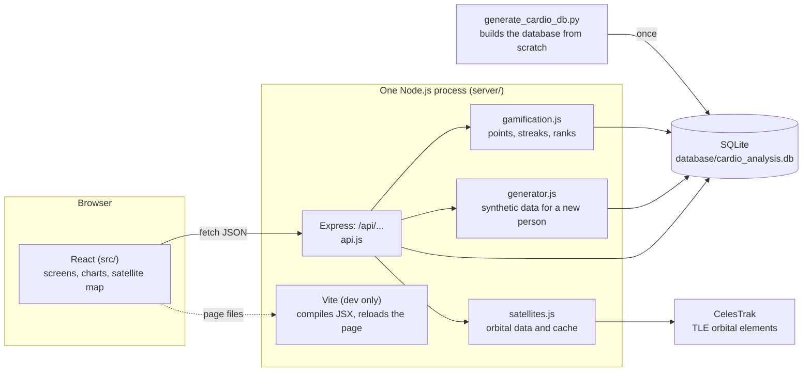
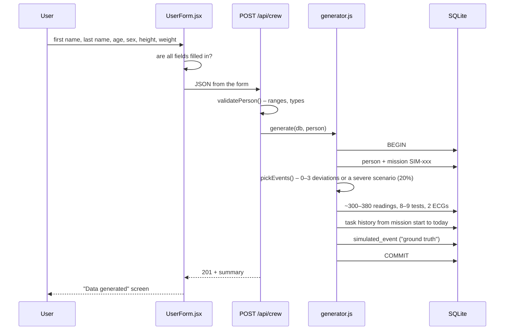
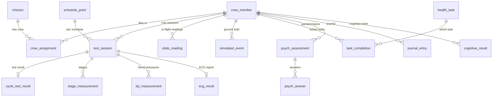

# Health Monitor – astronaut health monitoring system

Long space missions expose astronauts to radiation, isolation, altered gravity and a confined,
hostile environment. The effects include immune changes, bone loss, cardiovascular events and
mental health problems. On a long mission the doctor is far away, so the astronaut has to notice
for themselves that something is changing.

**Health Monitor** is an app in which astronauts track their own health: colour-coded vital signs,
a body silhouette showing what is working well, charts covering the whole mission, fitness test and
ECG results, a wellbeing questionnaire, cognitive tests, daily tasks with points and badges, and
plain-language explanations of every measurement. It also includes a satellite visualisation that
shows satellites on a world map with their current position, ground track and basic orbital data.

> **Important:** all personal and medical data in this project is **synthetic** (made up,
> generated by code). Only the reference tables, transcribed from NASA documents, are real.
> The app is not a medical device and does not replace a doctor.

## Contents

1. [Quick start](#1-quick-start)
2. [Architecture at a glance](#2-architecture-at-a-glance)
3. [Folder structure](#3-folder-structure)
4. [How data flows](#4-how-data-flows)
5. [Database](#5-database)
6. [Physiological model – where the numbers come from](#6-physiological-model--where-the-numbers-come-from) (including [outlier profiles](#66-outlier-profiles))
7. [Server – file by file](#7-server--file-by-file)
8. [Frontend – file by file](#8-frontend--file-by-file)
9. [Colour rules and thresholds](#9-colour-rules-and-thresholds)
10. [Tests](#10-tests)
11. [Code review findings](#11-code-review-findings)
12. [What to improve first](#12-what-to-improve-first)
13. [Glossary](#13-glossary)

---

## 1. Quick start

Requirements: **Node.js 22.13 or newer** (the project uses the built-in `node:sqlite` module;
tested on Node 26). Python 3 is only needed to rebuild the database from scratch.

```bash
npm install
```

```bash
npm run dev
```

The app runs at http://localhost:5173 (the API and the page share one port). The satellite
visualisation needs an internet connection to download orbital data.

| Command | What it does |
|---|---|
| `npm run dev` | Express server + Vite with live page reload |
| `npm run build` | builds the frontend into `dist/` |
| `npm start` | production mode: serves `dist/` (run `npm run build` first) |
| `npm test` | API tests on a temporary copy of the database (the real one is not changed) |
| `npm run seed:outliers` | adds 8 demo profiles with severe health problems ([section 6.6](#66-outlier-profiles)) |
| `python3 database/generate_cardio_db.py` | rebuilds the database from scratch (**deletes** users added in the app) |

Environment variables:

| Variable | Meaning | Default |
|---|---|---|
| `PORT` | server port | `5173` |
| `CARDIO_DB` | path to the database file (e.g. a copy to experiment on) | `database/cardio_analysis.db` |
| `NODE_ENV` | `production` serves `dist/` instead of running Vite | not set (development mode) |

Three things that are easy to trip over:

- **Windows / PowerShell.** If PowerShell blocks `npm` with a message that running scripts is
  disabled, use `npm.cmd run dev`. The `npm start` script uses the `NODE_ENV=production node ...`
  syntax, which works in bash but not in `cmd` or PowerShell. There, set the variable separately
  (`$env:NODE_ENV = 'production'`) and then run `node server/index.js`.
- **Changes in `server/` need a restart.** Vite live-reloads only the code in `src/`. Server code
  is loaded once, at start-up. After editing the API, stop the server (Ctrl+C) and start it again,
  or the browser keeps talking to the old version.
- **Port in use.** The message `Port 5173 is already in use` means a second copy of the app is
  already running. Stop it or choose another port with the `PORT` variable.

---

## 2. Architecture at a glance

The app has three layers and a single process:



| Layer | Technology | Why |
|---|---|---|
| Frontend | React 18 + Vite, Recharts, framer-motion | fast reload while working, ready-made charts, screen animations |
| Satellite map | satellite.js, d3-geo, topojson-client, world-atlas | orbits computed in the browser, land outlines without image files |
| Backend | Express 4 | a dozen or so simple JSON endpoints |
| Database | SQLite via the built-in `node:sqlite` | one file, nothing to install, no native modules to compile |
| Seed data | Python script with a fixed random seed | every run of the script produces the same data |

Key design decisions:

- **One port, one process.** In development Vite runs *inside* Express as middleware. There is no
  separate frontend server or proxy configuration, and the live-reload websocket uses the same
  HTTP server.
- **The database is the source of truth; everything else is derived.** Points, streaks, ranks and
  badges are not stored anywhere. The server computes them on every request from the
  `task_completion` table. Ticking a task inserts a row; un-ticking deletes it.
- **Shared browser and server code.** `src/assessments.js` (the questionnaire and its scoring
  function) is imported by both the screen and the server. The server computes the score, so it
  cannot be faked in the browser.
- **Synthetic data has a "ground truth".** Every deliberately simulated deviation from the norm is
  recorded in the `simulated_event` table, so you can check whether an analysis detects what was
  actually injected.
- **No login.** "Log in" means choosing a profile from the list. A deliberate simplification for the
  hackathon, discussed in [section 11](#11-code-review-findings).

---

## 3. Folder structure

```
HackatonHealthMonitoringSystem/
├── index.html                 shell page: <div id="root"> + src/main.jsx
├── package.json               npm scripts and dependencies
├── vite.config.js             Vite with the React plugin
├── .cache/celestrak/          copies of satellite data (created automatically, not in git)
│
├── server/                    backend (Node.js)
│   ├── index.js               entry point: Express + Vite (dev) or dist/ (production)
│   ├── db.js                  opens the database, creates missing tables, transactions
│   ├── api.js                 all /api endpoints
│   ├── generator.js           synthetic data generator for a new person
│   ├── gamification.js        points, streaks, ranks, badges
│   ├── satellites.js          downloads and caches orbital data from CelesTrak
│   ├── seed-outliers.js       adds "Outlier …" profiles with severe problems
│   ├── api.test.js            API tests (node:test)
│   └── satellites.test.js     orbital data tests (node:test)
│
├── src/                       frontend (React)
│   ├── main.jsx               mounts <App /> in #root
│   ├── App.jsx                small router based on the "#" part of the URL
│   ├── router.js              go(path): switch screens
│   ├── api.js                 API client (fetch + error handling)
│   ├── vitals.js              parameter definitions and the green/amber/red rule
│   ├── assessments.js         questionnaire and tests (shared with the server)
│   ├── styles.css             all styling, light and dark theme
│   └── screens/
│       ├── Login.jsx          choose a profile, add and delete; animated ECG background
│       ├── UserForm.jsx       "Generate user data" form; animated ECG background
│       ├── Dashboard.jsx      dashboard: Overview, Vitals, Fitness, ECG + tabs
│       ├── BodyMap.jsx        body silhouette coloured by status
│       ├── Wellbeing.jsx      questionnaire, journal, breathing, meditation
│       ├── Cognitive.jsx      6 cognitive tests
│       ├── Tasks.jsx          daily tasks and gamification
│       ├── Guide.jsx          guide to the indicators
│       └── Satellites.jsx     satellite map and live orbital data
│
├── database/
│   ├── cardio_analysis.db     SQLite database (in the repository)
│   ├── schema.sql             schema: tables, indexes, views
│   ├── schema.dbml            the same schema in DBML format (for diagrams)
│   ├── generate_cardio_db.py  builds the database from scratch
│   └── README.md              detailed description of the data
│
└── statsscreen.cpp / .h / .ui empty Qt window skeleton (unused, see section 11)
```

---

## 4. How data flows

### 4.1. New user ("Generate user data")



Everything runs in one transaction: if anything fails, no half-built profile is left in the
database.

### 4.2. Opening the dashboard

1. `Login.jsx` fetches `GET /api/crew` and shows the list of profiles.
2. Clicking "Log in" changes the URL to `#/crew/<id>`. `App.jsx` sees the change and renders
   `Dashboard`.
3. `Dashboard.jsx` sends **one** request, `GET /api/crew/<id>/dashboard`, and gets everything for
   the first four tabs: the person, missions, in-flight readings, normal ranges, tests, ECGs and
   simulated events.
4. The Wellbeing, Cognitive, Daily tasks and Guide tabs load their data only when opened.
5. The body silhouette (`BodyMap.jsx`) uses the dashboard data and only fetches questionnaire
   results.

The Satellite tracker screen fetches the chosen satellite group from `/api/satellites`; positions
and the ground track are computed in the browser from the TLE orbital elements.

### 4.3. Endpoints

All paths start with `/api`. Responses are JSON, and errors look like `{ "error": "message" }`.

| Method and path | What it does | Response codes |
|---|---|---|
| `GET /crew` | list of profiles added in the app | 200 |
| `POST /crew` | creates a person and generates their data | 201, 400 (with a `fields` list), 500 |
| `DELETE /crew/:id` | deletes a person with all their data | 204, 404 |
| `GET /crew/:id/dashboard?mission=` | dashboard data (mission optional) | 200, 403, 404 |
| `GET /crew/:id/tasks` | tasks, today's ticks, summary | 200, 403, 404 |
| `POST /crew/:id/tasks/:taskId` | `{ "done": true/false }` – ticks or un-ticks | 200, 403, 404 |
| `GET /crew/:id/wellbeing` | questionnaire history and journal | 200, 403, 404 |
| `POST /crew/:id/psych` | `{ "answers": [10 numbers] }` – the server computes the score | 201, 400, 403, 404 |
| `POST /crew/:id/journal` | `{ "text": "..." }` – journal entry | 201, 400, 403, 404 |
| `GET /crew/:id/cognitive` | cognitive test history | 200, 403, 404 |
| `POST /crew/:id/cognitive` | saves the result of one test | 201, 400, 403, 404 |
| `GET /guide` | guide topics | 200 |
| `GET /satellites` | available satellite groups | 200 |
| `GET /satellites?group=<code>` | TLE orbital elements of the chosen group | 200, 400 (unknown group), 502 |

**403** applies to the reference crew (see below): their data cannot be read through the API.
Satellite data comes from CelesTrak and is cached by the server for 2 hours (also on disk, in
`.cache/celestrak/`). If a refresh fails, the server returns the last good copy with
`"stale": true`.

### 4.4. Reference crew vs. profiles created in the app

The database holds two kinds of people, told apart by the `crew_member.created_in_app` column:

| | Reference crew (`0`) | Profiles from the app (`1`) |
|---|---|---|
| Source | Python script, 15 people | "Generate user data" form |
| Role | baseline for analysis ("blueprint") | regular app users |
| Login list | **hidden** | shown |
| Reading data via the API | **403** | allowed |
| Deleting | allowed via the API (not available on screen) | allowed |

The read block lives in one place: `api.param('id', ...)` in `server/api.js` runs before every
route with `:id` in its path. Server code (the generator, SQL views, analytical queries) reads the
database directly, so it still has access to the reference data.

---

## 5. Database

The full description of the tables and example queries are in
[database/README.md](database/README.md). This is the overall map.

### 5.1. Four groups of tables

| Group | Tables | Origin |
|---|---|---|
| **Reference** | `medical_requirement`, `schedule_point`, `protocol_stage`, `termination_criterion`, `test_constraint`, `equipment` | transcribed from NASA MRID JSC 28913: MEDB 1.6 (resting ECG) and N3.07 (cycle ergometer test) |
| **Norms** | `reference_range` | general clinical values for adults, **not** from NASA documents |
| **Crew data** | `crew_member`, `mission`, `crew_assignment`, `test_session`, `cycle_test_result`, `stage_measurement`, `bp_measurement`, `ecg_result`, `vitals_reading`, `simulated_event` | synthetic |
| **App** | `health_task`, `task_completion`, `indicator_guide`, `psych_assessment`, `psych_answer`, `journal_entry`, `cognitive_result` | definitions from the script, entries from the app |

### 5.2. How the tables relate



The key table is **`test_session`**: one session is one examination on a given day. A cycle test
has a summary result, measurements for each stage and blood pressures attached to its session.
An ECG has one report per session. The schedule point (`schedule_point`) says *which*
examination it is: L-90/30 d, FD 14, R+5 and so on.

### 5.3. Analysis views

| View | What it shows |
|---|---|
| `v_session_overview` | all sessions with name, mission and schedule label |
| `v_vo2_trend` | VO₂peak over time and % change against the L-90/30 d test |
| `v_vitals_alerts` | in-flight readings outside the norm (`warning` / `critical`) |
| `v_ecg_findings` | abnormal ECGs |

### 5.4. How much data there is

A freshly generated database: 15 people, 4 missions (HMS-1 … HMS-4), 155 test sessions, about
4,400 in-flight readings and about 34,000 ticked tasks (synthetic gamification history). Every
profile added in the app adds one `SIM-xxx` mission, 10–11 sessions and 300–380 readings.

### 5.5. Backward compatibility

At start-up `server/db.js` creates the `simulated_event`, `psych_assessment`, `psych_answer`,
`journal_entry` and `cognitive_result` tables if they are missing (`CREATE TABLE IF NOT EXISTS`).
An older copy of the database therefore works without a separate migration.

---

## 6. Physiological model – where the numbers come from

This is the most interesting part of the code. The data is not random noise: every person has
their own starting point, and all measurements follow from it. The same model is written twice:
in Python (`database/generate_cardio_db.py`, reference crew) and in JavaScript
(`server/generator.js`, profiles from the app).

### 6.1. Personal baseline

Drawn once for each person:

| Parameter | Range | Notes |
|---|---|---|
| Pre-flight VO₂peak | 39–48 (M), 33–42 (F) ml/kg/min | regular cyclists in the reference crew +3 |
| "Responder" factor | 0.5–1.3 | 1 = average loss of fitness in flight |
| Resting heart rate | 52–68 /min | |
| Resting blood pressure | 108–126 / 66–80 mmHg | |
| Skin temperature | 33.6–34.3 °C | |
| Respiratory rate | 13–16 /min | |
| ECG intervals | PR 135–185, QRS 84–102, QTc 388–425 ms | QTc in women +10 ms |

Every later value is:
**baseline + flight phase effect + optional deviation + measurement noise**.

### 6.2. Fitness across mission phases

Average VO₂peak multiplier relative to the pre-flight value:

| Test | Multiplier | Meaning |
|---|---|---|
| L-90/30 d (upright) | 1.00 | reference point |
| L-90/30 d (supine) | 0.92 | lying down gives a lower result |
| FD 14 | 0.86 | largest drop early in flight |
| FD 75 | 0.90 | partial recovery thanks to exercise |
| R-14 | 0.92 | |
| R+5 | 0.85 | just after landing, back in gravity |
| R+30 | 0.96 | almost full recovery after a month |

For in-flight and post-flight tests, the loss is multiplied by the personal "responder" factor.
Someone with 0.5 loses about 7% at FD 14; someone with 1.3 about 18%.

### 6.3. From VO₂peak to the test itself

1. **Peak power.** The ACSM cycling equation: `VO₂ = 10.8 × W / mass + 7` (ml/kg/min).
   The code solves it for watts: `W = (VO₂peak − 7) × mass / 10.8`.
2. **Stages.** The N3.07 protocol: a 3-minute first stage, then a higher load every minute.
   *Nominal*: 50, 75, 100 … 475 W. *Light* (under 65 kg): 45, 60, 75 … 300 W. All stages up to
   peak power are completed.
3. **Station limit.** The CEVIS bike is limited to 350 W. When the limit is reached, the last stage
   is extended to 3 minutes.
4. **Peak heart rate.** Tanaka's formula: `208 − 0.7 × age`, with a personal offset of ±6.
5. **Heart rate and exertion per stage** rise with the share of the way from rest to peak.
6. **RER** (ratio of exhaled CO₂ to consumed O₂) of at least 1.10 means a truly maximal effort.
   A stopped test has 1.00–1.06.
7. **Blood pressure.** Systolic rises by about 0.27 mmHg per watt and falls exponentially after
   the test.
8. **No gas analyser** means no VO₂ value (`NULL` in the database).

### 6.4. In-flight readings

Two readings a day (about 06:00 and 19:00) for the whole mission:

- **Adapting to weightlessness.** For the first 10 days fluids shift towards the head. Blood
  pressure drops by about 4/2 mmHg and heart rate by about 3 beats.
- **Daily rhythm.** In the evening systolic pressure +3 mmHg, heart rate +6, skin temperature
  +0.3 °C.
- **Normally distributed noise** (blood pressure ±4, heart rate ±3, SpO₂ ±0.6).

### 6.5. Deviations from the norm

Each profile from the app randomly gets 0 deviations (20% chance), 1 (40%), 2 (28%) or 3 (12%),
without repeats, from a list of eleven:

| Kind | Duration | What changes |
|---|---|---|
| `hypertension` | 25–50 days, second half of the mission | blood pressure rises gradually: +12 → +28 / +7 → +16 mmHg |
| `hypotension` | 4–8 days | blood pressure −20…−26 / −10…−14, heart rate +8 |
| `tachycardia` | 3–6 days | resting heart rate 102–125, respiration +1.5 |
| `bradycardia` | 10–20 days | heart rate −13 |
| `fever` | 3–6 days | skin temperature +1.5…+2, heart rate +14, respiration +2.5 |
| `co2` | 3–5 days | respiration +4.5…+6, SpO₂ −2.3…−3.5, heart rate +6 |
| `desaturation` | 1–3 days | SpO₂ −6…−8.5, respiration +3, heart rate +10 |
| `artifacts` | 4–8 single readings | one implausible value while the others are normal |
| `deconditioning` | whole mission | "responder" 1.8–2.1: VO₂peak drops by 25–30% |
| `ecg` | post-flight ECG | first-degree AV block, prolonged QTc or a single PVC |
| `test_stopped` | R+5 test | stopped because of shortness of breath |

Two things here are well thought out:

- **An illness changes several parameters at once.** Fever means temperature *and* heart rate
  *and* breathing. An analysis can therefore recognise a pattern, not just a single value out of
  range.
- **A sensor artefact looks different from an illness.** One absurd value (SpO₂ 82%, heart rate
  155) in a single reading, with everything else normal. A good analysis should treat it as a
  measurement error.

Everything that was simulated goes into `simulated_event`, with its start and end days.

### 6.6. Outlier profiles

80% of generated profiles get 0–3 ordinary deviations, often visible only as amber tiles in the
middle of the mission. The other 20% get one of five random scenarios with **severe** problems.
In addition, eight named outlier profiles can be created for demos. Their names say straight away
what is wrong:

| Profile on the login list | What the dashboard shows |
|---|---|
| Outlier Hypertension (severe) | blood pressure rising to about 175/105 mmHg (red) |
| Outlier Hypotension + Bradycardia | blood pressure below 70/45, heart rate below 40 (red) |
| Outlier Fever + Tachycardia | skin temperature about 37.5 °C, heart rate over 130 (red) |
| Outlier Low Oxygen (SpO2) + High CO2 | SpO₂ about 80%, respiration over 25 /min (red) |
| Outlier Fitness Loss + Stopped Test | VO₂peak more than 25% below pre-flight, stopped R+5 test (red legs) |
| Outlier Abnormal ECG (long QTc) | QTc over 460 ms in the post-flight ECG (amber heart) |
| Outlier Low Mood + Poor Sleep | questionnaire score of about 7% (amber brain) |
| Outlier Multi-System Failure | everything at once: blood pressure, fever, low oxygen, fitness, ECG, mood |

```bash
npm run seed:outliers
```

How it works:

- `server/seed-outliers.js` calls the same generator as the form, but with the `outlier` option.
  The generator then uses exactly the given deviations in their **severe** version (values reach
  the red range), and the episodes last until the last day of flight. That way they show in the
  latest reading, i.e. on the tiles and on the body silhouette.
- With severe fitness loss, the drop also persists after return (the R+30 test), so the legs on
  the silhouette stay red.
- These are ordinary app profiles (`created_in_app = 1`): they are on the login list and can be
  deleted with the Delete user button. The script can be run repeatedly: a profile whose name
  already exists is skipped.
- ECG and mood can make the silhouette amber at most, because that is how their rules work
  (section 9).
- A test in `server/api.test.js` checks that every outlier profile has the expected values in the
  red range.

#### Possible causes and false alarms

The examples below show that similar symptoms can have different causes. Before treating an
abnormal result as a health problem, check that it is not a measurement error.

| Pattern | Possible causes in spaceflight | Possible measurement error |
|---|---|---|
| Hypertension | stress and workload, lack of sleep, salty meals, high cabin CO₂, pre-existing hypertension | wrong cuff size, measured right after exercise or while talking |
| Low blood pressure and bradycardia | dehydration, fluid shift in weightlessness, cardiovascular deconditioning, medication, naturally low heart rate in a trained person | measured right after waking, badly placed sensor |
| Fever and tachycardia | infection, reactivation of a latent virus, dehydration, overheating during exercise or a spacewalk | skin sensor warmed by exercise or a hot environment |
| Low SpO₂ and high CO₂ | problem with cabin air scrubbing or airflow, respiratory infection, fluid in the lungs | cold fingers or a badly fitted pulse oximeter |
| Fitness loss and stopped test | too little exercise, equipment failure, injury, muscle and heart deconditioning in weightlessness, arrhythmia during exercise | effort was not maximal or the gas analyser malfunctioned |
| Abnormal ECG (long QTc) | low potassium or magnesium, QTc-prolonging medication, changes in heart function after a long flight | misplaced electrodes, QTc over-corrected at a high heart rate |
| Low mood and sleep problems | isolation, no normal day-night rhythm, noise, workload, crew conflicts, distance from loved ones | answered at a bad moment; a single low score is not a trend |
| Several systems at once | one serious cause, e.g. an infection or a cabin air system failure | simultaneous failure of many sensors is unlikely |

Three questions help when assessing results:

- **Does the problem affect the whole crew?** Low SpO₂ or high CO₂ in several people at once may
  point to a cabin air problem. This pattern is simulated in mission HMS-2.
- **Is it a single reading or a lasting trend?** A single extreme value surrounded by normal
  readings more often points to a sensor artefact. The generator simulates such errors too.
- **Do the parameters change together?** Fever usually comes with a rise in heart rate and
  breathing rate. A high temperature alone, with other readings normal, may point to a sensor
  error.

This is general educational information, not medical advice. On a real mission, health is
assessed by the mission's flight surgeon.

---

## 7. Server – file by file

### `server/index.js` – entry point

Opens the database, creates the Express app and creates the HTTP server by hand (so Vite can
attach its websocket to it). It mounts the API under `/api` first. Then, depending on the mode, it
serves the built files from `dist/` or runs Vite as middleware. It also turns a port-in-use error
into a readable message.

### `server/db.js` – database access

- `openDb()` checks that the file exists, turns on foreign keys (`PRAGMA foreign_keys = ON`;
  SQLite leaves them off by default for every connection), runs a test query and creates any
  missing tables.
- `transaction(db, fn)` is `BEGIN` / `COMMIT`, with `ROLLBACK` on an exception. `node:sqlite` is
  synchronous, so nothing else runs in the middle of a transaction.
- `plain(rows)` turns rows into plain objects (easier for JSON and tests).

### `server/api.js` – endpoints

`createApi(db)` receives the database as an argument, so the tests can run the same API on a
temporary copy. Four places are worth knowing:

- **The `api.param('id')` guard** – the one place that blocks reading reference crew data.
- **`DELETE /crew/:id`** – the schema has no `ON DELETE CASCADE`, so deletion is done by hand, from
  children to parents: session results → the person's rows → the person → missions nobody uses
  any more.
- **`GET /crew/:id/dashboard`** – builds the response from seven queries and adds
  `pct_vs_preflight` to every test, i.e. the VO₂peak change against the L-90/30 d (upright) test of
  the same mission.
- **`POST /crew/:id/psych`** – the server computes the score itself with `scorePsych` and, in one
  transaction, saves the assessment and answers and ticks the "How do you feel?" daily task.

### `server/satellites.js` – orbital data

Downloads TLE orbital elements for a chosen satellite group from CelesTrak and serves them through
`GET /api/satellites`. Important details:

- **Allowed groups only** (`SATELLITE_GROUPS`). An unknown code returns 400, so the server cannot
  be used to send arbitrary requests to CelesTrak.
- **A 2-hour cache**, in process memory and in `.cache/celestrak/<group>.json` files (the folder is
  in `.gitignore`). CelesTrak updates its data about every 2 hours and **refuses** to send the same
  group again within that time. Without the copy on disk, every server restart could mean up to
  2 hours without data.
- **Last good copy.** When a refresh fails (no network, CelesTrak refuses), the server returns the
  previous data with `stale: true`, and the screen says so.
- **`parseTle()`** reads the three-line format (name, line 1, line 2) and skips everything else,
  such as plain-text error messages that CelesTrak sends with status 200.

### `server/generator.js` – data generator

The `Generator` class builds one person. The order in `run()` matters:

1. the person's baseline,
2. the `crew_member`, `mission`, `crew_assignment` rows,
3. `pickEvents()` – choosing deviations (nothing is saved yet),
4. `vitals()`, `cycleTests()`, `ecgs()` – data already including the deviations,
5. saving the deviations to `simulated_event`,
6. generating the task history from mission start to the current day.

The task history uses a separate completion chance for each kind of task and lower activity after
the mission. For each entry, `task_completion.created_in_app` is randomly set to `0` or `1`. All
randomness goes through `makeRandom(rand)`, so a test can pass its own random source and get
repeatable data. `validatePerson()` checks the form (all fields required, age 18–99, height
150–230 cm, weight 40–200 kg) and accepts a decimal comma.

### `server/gamification.js` – gamification

`computeSummary()` computes everything from scratch on every request:

| Element | Rule |
|---|---|
| Daily goal | 50 points |
| Points | sum of points of ticked tasks (all 8 tasks = 80 points a day) |
| Streak | consecutive days with at least one task; a missing today does not break it if yesterday had one |
| Rank | points from the last 30 days: Cadet 0, Specialist 300, Pilot 700, Flight Engineer 1100, Commander 1500, Space Ace 1900 |
| Badges | 7: first step, 7- and 30-day streak, 30 morning checks, 50 workouts, 8 guide topics, perfect day |

A rank based on a 30-day window rather than all-time points reflects the current habit. Stop, and
you drop.

---

## 8. Frontend – file by file

### Skeleton

- **`main.jsx`** mounts `<App />`.
- **`App.jsx`** is a router based on the `#` part of the URL: `#/` (login), `#/new` (form),
  `#/crew/<id>` (dashboard), `#/satellites` (satellite visualisation). The part after `#` never
  reaches the server, so Express needs no routes for screens, and the Back button and page reload
  just work.
- **`api.js`** is a thin wrapper around `fetch`. On an error it throws an exception with the
  server's message, which screens show as is.
- **`vitals.js`** holds the list of six parameters and the `classify()` function (the colour rule).
- **`styles.css`** is all the styling. Colours are CSS variables, and the dark theme switches on
  automatically from the system setting.

### Screens

| File | What it does | Worth noting |
|---|---|---|
| `Login.jsx` | profile list, Log in, Add user, Delete user; Satellite Visualisation button in the top-right corner | only profiles from the app are listed; deleting asks for confirmation; animated ECG line in the background |
| `UserForm.jsx` | form and summary screen | the summary shows the deviations and the number of generated tasks; same ECG background as the login screen |
| `Dashboard.jsx` | header, tabs, Overview, Vitals, Fitness, ECG | one request for four tabs; choosing a mission reloads the data |
| `BodyMap.jsx` | silhouette with five areas | the colour is the worst status of the assigned readings; a click opens the tab |
| `Wellbeing.jsx` | questionnaire, chart, journal, breathing, meditation | a small state machine; the timer is based on the clock, not on counting ticks |
| `Cognitive.jsx` | 6 cognitive tests | timing with `performance.now()`; the browser computes the score |
| `Tasks.jsx` | tasks, points, streak, rank, badges | after every click the server sends back the whole recalculated summary |
| `Guide.jsx` | expandable guide by topic | content comes from the `indicator_guide` table |
| `Satellites.jsx` | world map, ground track, position and data of the chosen satellite | positions from TLE are computed in the browser with the SGP4 model, refreshed every second |

### Login and form animations

The login and "Generate user data" screens draw an ECG line on a full-screen `<canvas>` behind
the card. Every few seconds it smoothly switches between a calm green trace and a faster red
"alarm" trace. The cards appear with a `framer-motion` animation.

### Satellite visualisation (`Satellites.jsx`)

The "Satellite Visualisation" button in the top-right corner of the login screen opens
`#/satellites`; no profile needs to be chosen. Available groups (CelesTrak codes in brackets):

| Group | Code | Number of objects (approximate) |
|---|---|---|
| Space stations | `stations` | about a dozen (the default, with the ISS selected) |
| Brightest | `visual` | about 150 of the brightest, visible to the naked eye |
| Weather | `weather` | about 70 |
| GPS | `gps-ops` | about 30 |
| Galileo | `galileo` | about 30 |
| Science | `science` | about 45 |
| Geostationary | `geo` | about 560 |
| Starlink | `starlink` | over 10,000 |

How the screen works:

1. After a group is chosen, the browser fetches `GET /api/satellites?group=<code>`, i.e. the TLE
   list (a name plus two lines of orbital elements per object).
2. `satellite.js` turns each TLE into an orbit model (`twoline2satrec`), and every second the SGP4
   model computes the current position, altitude and speed.
3. The map is a flat equirectangular projection (longitude → x, latitude → y) drawn on a
   `<canvas>` element. Land outlines come from `world-atlas`, and `d3-geo` clips polygons that cross
   the date line.
4. The chosen satellite (click a dot or use the "Find satellite" field) gets a ground track: one
   orbit back (faint) and one ahead. Below the map are its latitude, longitude, altitude, speed,
   orbital period and NORAD number.
5. The shaded area is the night side of the Earth, and the yellow dot is the point where the Sun is
   directly overhead (approximate astronomical formula, accurate to about 0.01°).

For groups with thousands of objects the dots are smaller (smaller still on narrow screens), so
the map stays readable.

### Body silhouette (`BodyMap.jsx`)

| Area | Colour source | Opens |
|---|---|---|
| Brain | latest questionnaire (amber below 60%) | Wellbeing |
| Heart | heart rate, systolic and diastolic pressure, latest ECG | Vitals |
| Lungs | respiratory rate, SpO₂ | Vitals |
| Skin (head, torso, arms) | skin temperature | Vitals |
| Legs | VO₂peak drop; red when the latest test was stopped | Fitness |

The drawing is SVG written in the code (no image files). The left arm, leg and lung are drawn
once, and the right side is a mirror image.

### Cognitive tests (`Cognitive.jsx`)

| Test | How it runs | Result |
|---|---|---|
| Reaction Time | 5 trials; signal after a random 1.5–3.5 s; clicking too early = false start and retry | average time in ms, number of false starts |
| Digit Memory | 5 rounds, 3 to 7 digits, shown for longer each time | correct / 5 |
| 2-Back | 12 digits; from the third on, "same as two back?" | correct / 10 |
| Matrix Reasoning | 5 number matrices, answer order shuffled | correct / 5 |
| Spatial Orientation | 5 mental rotation tasks | correct / 5 |
| Digit-Symbol | 10 symbol → digit matches, 60 s limit, keys 1–5 | correct / 10 and time |

### Wellbeing questionnaire

10 questions, each worth up to 10 points (the maximum is 99, because one question gives at most
9). Sliders go from 0 to 10. Some are reversed (high stress means few points). Choice questions
have points assigned to each answer. A score below **60%** shows a recommendation to contact the
support team and offers activities: a journal, a breathing exercise (3 minutes, a cycle of 4 s in,
4 s hold, 6 s out, 2 s pause) and meditation (5 minutes).

---

## 9. Colour rules and thresholds

### Vital signs

The rule from `src/vitals.js`: within the norm = green, outside the norm but within the critical
range = amber, outside the critical range = red.

| Parameter | Normal (green) | Red limits |
|---|---|---|
| Systolic pressure | 90–130 mmHg | below 70 or above 160 |
| Diastolic pressure | 60–85 mmHg | below 45 or above 100 |
| Resting heart rate | 50–100 /min | below 40 or above 130 |
| Respiratory rate | 12–20 /min | below 8 or above 25 |
| Skin temperature | 32.5–35.5 °C | below 31.5 or above 36.5 |
| SpO₂ | 95–100% | below 92 |

### Other thresholds

| What | Amber | Red | Where in the code |
|---|---|---|---|
| VO₂peak drop against the pre-flight test | over 10% | over 20% | `fitnessStatus()` in `vitals.js` |
| Cycle test | – | stopped | `Dashboard.jsx`, `BodyMap.jsx` |
| ECG: PR / QRS / QTc | outside 120–200 / 70–110 / 350–450 ms (QTc up to 460 for women) | – | `ecgLimits()` in `vitals.js` |
| ECG: report | `abnormal` flag | – | database |
| Questionnaire | below 60% | – | `assessments.js` |

---

## 10. Tests

```bash
npm test
```

`server/api.test.js` (built-in `node:test`, no extra libraries) copies the database to a
temporary folder, runs the real API on it on a random port and sends HTTP requests. The real
database is not changed. `server/satellites.test.js` checks TLE parsing and the cache (including
saving to disk) without contacting the external service.

| Test | What it checks |
|---|---|
| form validation | empty fields, wrong age, height, sex; list of missing fields |
| full cycle | create → list → dashboard → tick a task → delete with no traces left in the database |
| reference crew | hidden from the list, reading their data returns 403 |
| deleting | any profile can be deleted, the database stays consistent |
| data variety | 40 generated people: at least 7 kinds of deviation, alerts match the event windows, healthy profiles have few alerts |
| wellbeing and cognitive tests | scoring, threshold, journal, result validation, clean-up after deletion |
| outlier profiles | 8 profiles on the list, their latest values in the red range, no duplicates on a re-run |
| satellite data | TLE parsing, cache, last copy after a CelesTrak error, copy on disk after a restart |
| task history and severe scenarios | history spans mission start to today, random choice of a severe scenario |

`npm test` currently runs 11 tests. The frontend has no automated tests.

---

## 11. Code review findings

This section describes what actually follows from reading all of the code: what is done well and
where the hidden traps are.

### Strengths

1. **The data has a causal structure.** The "baseline + phase + deviation + noise" model produces
   data on which real trend analysis can be practised. The formulas (ACSM, Tanaka, Bazett) are used
   correctly and consistently, e.g. QT is computed from QTc and heart rate, so both values agree.
2. **`simulated_event` is a built-in answer key.** Rare in hackathon projects: you can count how
   many simulated events an analysis detected and how many alerts were false.
3. **Few moving parts.** One process, one port, one database file, nine production dependencies
   (four of them for the satellite map). The project starts in a minute.
4. **The server computes the questionnaire score** with a shared function, so it cannot be faked.
5. **Transactions where they matter.** Generating a profile, deleting and saving the questionnaire
   are atomic.
6. **Tests hit the real API** on a copy of the database, not mocks.

### Traps and limitations

**Security and data**

1. **There is no authentication.** Anyone who can reach the address can open any app profile, read
   its journal and delete it. The 403 for the reference crew is a visibility rule, not protection.
   For real medical data this is unacceptable.
2. **The reference crew can be deleted through the API.** The screen does not allow it (the
   profiles are hidden), but `DELETE /api/crew/1` works and permanently removes part of the
   baseline. Restoring it requires the Python script, which…
3. **…wipes the whole database.** `generate_cardio_db.py` deletes the file first. All users from
   the app, their questionnaires and journals are lost. There is no "restore only the baseline"
   mode.
4. **The database is in the repository and changes with normal use.** Every added user and every
   ticked task modifies `database/cardio_analysis.db`, a binary file tracked by git. The result: a
   permanent "modified file" in `git status` and unresolvable conflicts when several people work
   on it. To experiment, use a copy via `CARDIO_DB`.

**Duplicated logic (several sources of truth)**

5. **The physiological model exists in two languages** and has already drifted apart:

   | Rule | Python (reference crew) | JavaScript (app) |
   |---|---|---|
   | "Light" protocol | under 65 kg and not a cyclist | under 65 kg |
   | Hypertension | +12 → +26 mmHg | +12 → +28 mmHg |
   | Bradycardia | −12 /min | −13 /min |
   | Kinds of deviation | 4 + ECG variants, chosen by hand | 11, random |
   | Submaximal test, test without gas analysis | present | absent |

   The differences are small, but they matter when comparing the two groups.
6. **The colour rule is in two places:** `classify()` in JavaScript and the `v_vitals_alerts` view
   in SQL. Today they give the same result because both read `reference_range`, but a change of
   logic in one place will not change the other.
7. **The VO₂peak change against the pre-flight test is computed twice:** in `api.js` and in the
   `v_vo2_trend` view. The API version also includes stopped tests; the view only completed ones.
8. **Fitness and ECG thresholds are hard-coded in the frontend**, not in `reference_range`. They are
   already in one place (`fitnessStatus()` and `ecgLimits()` in `src/vitals.js`), but SQL analysis
   cannot see them.
9. **Fixed: form hints vs. server limits.** The "Generate user data" placeholders suggested
   120–230 cm and 35–200 kg, while `validatePerson()` accepts 150–230 cm and 40–200 kg. The hints
   now show the server's limits. The limits are still written in two places (`UserForm.jsx` and
   `generator.js`), so a change must be made in both.

**Content inconsistencies**

10. **Fixed: the guide vs. the colours.** The VO₂peak topic spoke of a drop of more than 15%, while
    the interface turned amber at 10% and red at 20%. The guide now gives the same two thresholds.
11. **Fixed: QTc for women.** The code used 450 ms for everyone, although the normal limit for
    women is 460 ms. The ECG tab now uses a sex-specific limit.
12. **Fixed: the questionnaire could not reach 100%.** The maximum was computed as 10 questions ×
    10 points, but no answer to the self-regulation practice question gives 10. The maximum is now
    the best achievable score (99 points), so the best answers give 100%.
13. **A healthy athlete is sometimes "amber".** Resting heart rate is drawn from 52 upwards, and
    after in-flight adaptation and noise some readings fall below 50, i.e. below the lower normal
    limit. Yet the ECG in the same model describes such a heart rate as physiological in a trained
    person. The norms are population norms, not personal ones.
14. **Skin temperature is not body temperature.** The guide explains this, but the colour on the
    silhouette may suggest more than the sensor really knows.

**Silhouette and overview**

15. **The silhouette and tiles look only at the latest reading.** One sensor artefact in the latest
    reading changes the colour of a body part, while three weeks of hypertension that ended the day
    before leave no trace. A trend over several days would be closer to what the guide advises.
16. **The overview shows the answers.** The "Simulated deviations" section on the Overview tab lists
    the simulated events. Great for demos, but in a real product this would be giving away the
    diagnosis before the analysis.

**Cognitive tests**

17. **The server trusts the browser.** The tests depend on timing, so the browser scores them. The
    server only checks that the numbers are within the possible range. A result can be sent by
    hand.
18. **Learning effect.** The Matrix and Spatial questions are always the same five tasks (Matrix
    only shuffles the answer order). In 2-Back the matches always fall on positions 4, 6, 9 and 11.
    After a few attempts the score measures memory of the tasks, not mental performance. This
    undermines the purpose of the tests, which is tracking change against one's own baseline.
19. **No interpretation.** Results are saved and shown, but there are no thresholds, no trend and
    no effect on the body silhouette.

**Time and technology**

20. **Two time zones.** Daily tasks use the server's local date, while questionnaires and the
    journal use UTC. For an astronaut in orbit, the server's "day" on Earth may not be their day.
21. **The synchronous database blocks the server.** `node:sqlite` runs queries on the main thread.
    For one person this does not matter; with many simultaneous users, generating a profile stalls
    everyone else.
22. **The dashboard sends the whole mission at once** (300–380 readings plus all ranges). It is
    small data for now, but there is no paging.
23. **The variety test is random.** It uses unseeded `Math.random` and checks statistical
    properties (e.g. at least 7 kinds of deviation across 40 people). The chance of a random
    failure is very small but not zero. Two real causes of occasional failures are already
    **fixed**: tachycardia overlapping bradycardia (−13 beats brought the heart rate back into the
    normal range; tachycardia is now applied last) and the test connection being dropped when
    generating 40 people blocked the server for more than 5 seconds.
24. **A new profile's task history is synthetic.** The generator creates random completions from
    mission start to today, with lower activity after return. The gamification score does not
    reflect the astronaut's actual behaviour. The `task_completion.created_in_app` column is also
    random (`0` or `1`), so it cannot tell generated entries from the user's clicks.
25. **The `statsscreen.cpp`, `.h`, `.ui` files** are an empty Qt (C++) dialog skeleton, probably
    left over from an earlier idea for a desktop app. Nothing uses them.
26. **App profile data is "frozen".** The generator creates a finished mission (return 5–6 weeks
    ago). No new vital signs arrive; only tasks, questionnaires and cognitive tests grow.

**Satellite map**

27. **Depends on an external service.** Without internet (or when CelesTrak is down) the first time
    a group is opened ends in a 502 error. After that the server uses the copy saved on disk, but if
    it is older than 2 hours, positions are computed from older orbital elements.
28. **Positions are approximate.** SGP4 with TLE data has an error of the order of kilometres,
    growing with the age of the data. Good enough for visualisation, not for planning manoeuvres.
29. **The feature is independent of the rest.** The map does not use the database or the
    astronaut's profile; for example, it does not show which station the chosen person is on.

**Screen animations**

30. **The ECG background animates constantly.** The login and form screens redraw a full-screen
    canvas on every frame and ignore the system's "reduce motion" setting. Its red "alarm" phase
    on a screen with no patient data may also suggest an alert that does not exist.

---

## 12. What to improve first

From the biggest gain for the least effort:

1. **Take the database out of the repository** (keep the script and schema, generate the file on
   install) or work on a copy by default. This removes the git conflicts.
2. **One source of thresholds.** Move the VO₂ and ECG thresholds from `src/vitals.js` into
   `reference_range`, so SQL views can use them too.
3. **Silhouette from a trend, not one reading.** For example the median of the last 3 days, with
   single outliers marked as a possible artefact.
4. **Protect the baseline.** Bring back the API block on deleting the reference crew, or add a mode
   to the script that restores only the baseline without deleting users.
5. **Random cognitive tasks** (generated matrices, random match positions in 2-Back) to limit the
   learning effect.
6. **One generator model.** Either call the same code that builds the baseline from the app, or
   keep the constants (phase multipliers, event strength) in a shared JSON file read by both
   languages.
7. **Authentication**, if the project is to go beyond a demo.
8. **Automatic server restart** on code changes (`node --watch server/index.js`), so the manual
   restart is not forgotten.

---

## 13. Glossary

| Term | Meaning |
|---|---|
| **VO₂peak** | the highest oxygen uptake during maximal exercise (ml/kg/min); the best single measure of cardiorespiratory fitness |
| **Cycle ergometer** | stationary bike with an adjustable load in watts |
| **CEVIS** | the cycle ergometer on the International Space Station, limited to 350 W |
| **PPFS** | portable breath gas analyser (measures VO₂) |
| **N3.07** | NASA medical requirement: cycle ergometer fitness test |
| **MEDB 1.6** | NASA medical requirement: resting 12-lead ECG |
| **L-90, FD 14, R+5** | days before launch (Launch), flight day (Flight Day), days after return (Return) |
| **RER** | ratio of exhaled CO₂ to consumed O₂; at least 1.10 indicates maximal effort |
| **RPE** | perceived exertion on the Borg 6–20 scale |
| **SpO₂** | blood oxygen saturation measured with a pulse oximeter |
| **PR, QRS, QT, QTc** | intervals in an ECG trace; QTc is QT corrected for heart rate (Bazett's formula) |
| **First-degree AV block** | slowed conduction between the atria and ventricles (PR above 200 ms) |
| **PVC** | premature ventricular contraction, an "extra beat" of the heart |
| **Artefact** | a wrong reading caused by movement, a cold finger or a badly fitted sensor |
| **Reference crew** | 15 fictional astronauts from the Python script; the baseline for analysis |
| **Ground truth** | the list of what was deliberately simulated (`simulated_event`) |
| **CelesTrak** | public service with up-to-date satellite orbital elements |
| **TLE** | Two-Line Element set: a name and two lines of text describing a satellite's orbit at a given moment |
| **SGP4** | the standard model for computing a satellite's position from TLE data |
| **NORAD ID** | catalogue number of an object in orbit (the ISS is 25544) |
| **Terminator** | the boundary between day and night on the Earth's surface |
